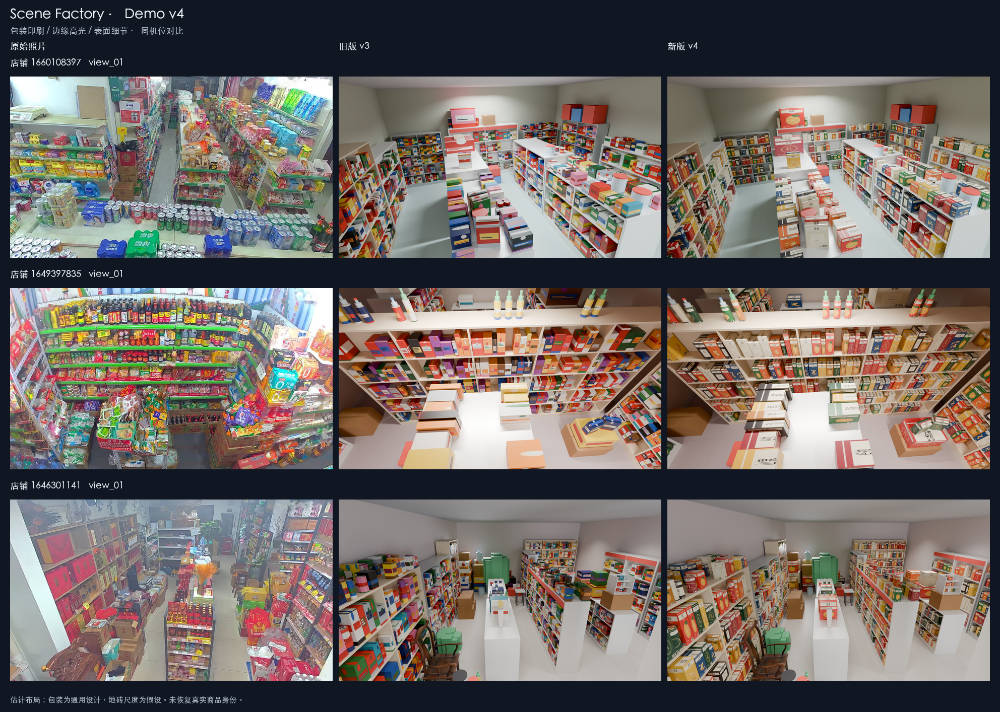

# Demo v4：商品包装与表面细节

2026-11-04。本轮使用已有 v3 的可编辑 Blender 工程，新增材质细化步骤，不调用布局模型。输出三家店、六个机位，1920×1080、Cycles 256 采样、Metal、AgX Punchy。



## 改动

- 将原 512×512、8×8 的抽象色块包装图集替换为 2048×2048、8×8 的通用包装图集。增加中文品类字样、细印刷线、条码、折边和插画，沿用原 UV；不是原照片中的真实商品或 SKU。
- 商品材质增加轻微涂层和微凹凸；商品网格增加 1.2 mm、两段倒角，改善边缘高光。三个场景分别处理 74、82、64 个商品材质节点与网格。
- 墙面、天花板增加轻微凹凸；地面增加**假设为 0.6 m**的地砖接缝，粗糙度设为 0.44。纹理与尺度均为外观假设，未经测量。
- 换材质后两家店偏亮，按店采用共享曝光偏移，各店两个渲染机位共用同一偏移。
- 修复拼图中文字体显示，增加三列同机位对比、逐店双机位对比和另一机位展示。图片等比缩放，不裁切，不做后期颜色校正。

| 店铺 | 本轮高清渲染机位 | 相对 v3 曝光偏移 |
| --- | --- | ---: |
| 1660108397 | view_01、view_07 | -0.25 EV |
| 1649397835 | view_01、view_08 | -0.45 EV |
| 1646301141 | view_01、view_08 | 0.00 EV |

工程保留全部原始相机，但本轮只重渲表中两个机位。最终交付保留 v3 相机参数，以便公平比较材质效果。

## 试验与取舍

1. **程序化印刷图集**：同机位可见包装细节增加，保留。
2. **原照片商品裁片**：试渲 1646301141/view_01；裁片带入原图的透视、模糊和烘焙明暗，未采用。裁片 JSON 和试渲保存在生产工作目录。
3. **俯仰与焦距**：三家各四组，共 12 张 640 px 小样。部分指标或构图改善，但没有稳定的结构收益，最终未采用。
4. **共享曝光**：两家店各两组，每组两个机位小样，再按选定偏移重出高清图。

## 验证结果

亮度误差为现有 tune_look.metrics 的 0–255 平均亮度差，所有图统一缩放到 480×270 后计算。以下来自最终高清图。

| 店铺 / 机位 | v3 亮度误差 | v4 亮度误差 |
| --- | ---: | ---: |
| 1660108397 / view_01 | 5.15 | 4.26 |
| 1660108397 / view_07 | 1.65 | 4.97 |
| 1649397835 / view_01 | 6.35 | 2.70 |
| 1649397835 / view_08 | 20.34 | 14.72 |
| 1646301141 / view_01 | 16.20 | 8.69 |
| 1646301141 / view_08 | 10.73 | 6.02 |

- 与旧 demo 相同的三个首机位：平均亮度误差 **9.23 → 5.22，降低约 44%**。
- 六个机位整体：平均亮度误差 **10.07 → 6.89，降低约 32%**；并非每个机位都改善。
- 三个首机位平均饱和度误差 **0.0227 → 0.0246**，略变差；平均模糊 SSIM **-0.0437 → -0.0380**。
- 结构指标仍然很低。新包装的纹理边缘也会影响梯度分，不能用分数的小幅上升证明几何更准确。

本轮改善的是材质观感和部分亮度匹配。房间、货架位置、货物密度和估计相机与照片的差异仍明显。下一步实质提升需针对相机与大件布局建立对应约束，或重建更接近照片的货架和商品几何。

## 输出

以下路径相对生产根目录 production_local：

- 拼图、逐店对比、另一机位展示、完整指标：weidian_full_runs/demo_final_v4_20261104/
- 六张高清 PNG、三个打包的 scene.blend、逐店参数：weidian_full_runs/demo_runs/demo_v4/<店铺ID>/
- 小样、相机与曝光试验、图集与裁片记录：weidian_full_runs/demo_optimization_20261104/
- 仓库演示副本：docs/weidian/demo/v4/。旧 demo 保留在 docs/weidian/demo/。

refinement.json 记录输入、机位、曝光偏移、材质处理计数、设备和耗时。scene_bundle.json 记录相机参数；重新构建材质还需要本轮图集和细化脚本。可编辑工程包含实际材质图与打包图像。

## 复现

在仓库根目录设置已有 v3 的根目录和新的输出目录。Python 需要 Pillow、numpy；本轮 Blender 为本机 5.2.0 LTS。输出不能与源目录相同。

```bash
PYTHON=.venv/bin/python
BLENDER=/Applications/Blender.app/Contents/MacOS/Blender
RUN_ROOT=/absolute/path/to/production_local/weidian_full_runs
ATLAS="$RUN_ROOT/demo_optimization_20261104/packaging_print.png"

"$PYTHON" tools/batch/make_packaging_atlas.py "$ATLAS" --seed 17 --tile-size 256

"$BLENDER" -b --python-exit-code 1 --python tools/batch/refine_demo_blender.py -- \
  --source "$RUN_ROOT/demo_runs/demo_v3/1660108397" \
  --out "$RUN_ROOT/demo_runs/demo_v4_repro/1660108397" \
  --views view_01 view_07 --atlas "$ATLAS" --detail --floor-tiles \
  --exposure -0.25 --edge 1920 --samples 256 --save

"$BLENDER" -b --python-exit-code 1 --python tools/batch/refine_demo_blender.py -- \
  --source "$RUN_ROOT/demo_runs/demo_v3/1649397835" \
  --out "$RUN_ROOT/demo_runs/demo_v4_repro/1649397835" \
  --views view_01 view_08 --atlas "$ATLAS" --detail --floor-tiles \
  --exposure -0.45 --edge 1920 --samples 256 --save

"$BLENDER" -b --python-exit-code 1 --python tools/batch/refine_demo_blender.py -- \
  --source "$RUN_ROOT/demo_runs/demo_v3/1646301141" \
  --out "$RUN_ROOT/demo_runs/demo_v4_repro/1646301141" \
  --views view_01 view_08 --atlas "$ATLAS" --detail --floor-tiles \
  --exposure 0 --edge 1920 --samples 256 --save

"$PYTHON" tools/batch/make_refined_demo_sheets.py \
  --before "$RUN_ROOT/demo_runs/demo_v3" \
  --after "$RUN_ROOT/demo_runs/demo_v4_repro" \
  --out "$RUN_ROOT/demo_final_v4_repro"
```

字体优先使用 STHeiti Medium；没有中文字体的机器应安装 NotoSansCJK 或调整路径。跨系统字体差异会改变图集字形。
