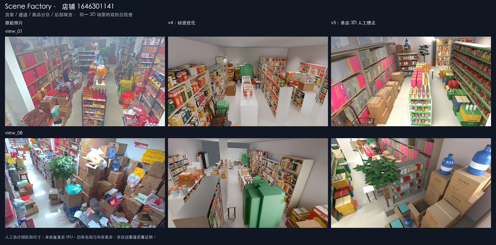

# Demo v5：单店布局与内容修正试验

2026-11-04。针对 **1646301141** 做人工结构修正，输出 view_01、view_08 两个机位，1920×1080、Cycles 256 采样、Metal。两个机位使用同一个可编辑 3D 场景，商品使用固定 UV 的小块物体纹理；没有按渲染机位替换画面或使用整帧背景。

这是单店人工试验，不能代表 494 家店的自动重建质量。其他店和 v3、v4 成果均保留。



## 实际改动

- 左侧柜体改为单面礼盒柜，按层改变大礼盒、双瓶盒和细长包装的尺寸与分布。修正柜体背板位置，给正面与侧面分别赋材质；UV 保持照片裁片比例。
- 中间低岛架增加朝向相机的端头库存和两侧库存，瓶罐、袋装商品和礼盒分别建模。袋装商品增加鼓起的轮廓和收口，避免全部表现为硬质小长方体。
- 右侧货架改为密集分层陈列，增加 12 种经过手工选区、透视展开的商品面纹理。它们来自本店 view_04，仍带有原始模糊与明暗，并未逐个恢复 SKU。
- 重建后部纸箱堆、开口箱、胶带、水桶、宽叶植物和小货架；普通纸箱与彩色整箱使用通用印刷图案。商品类型和堆放方式仍是估计。
- 修复茶桌移动时，杯罐等仍留在原位置的问题。原布局的 support_id 是语义关系，未形成 Blender 父子关系；现在移动完整的递归支撑组。
- 调整礼盒柜、岛架、隔断货架及两个相机，参数集中记录在 [scene_config.json](demo/v5/scene_config.json)。加入静态柔光补光，参数对两个机位共用；这些灯光也是外观估计。

## 对比指标

以下来自最终高清 PNG，沿用现有 `tune_look.metrics` 和 `score_alignment`。亮度误差按 0–255 计算；SSIM 是模糊灰度分块指标。

| 机位 | 版本 | 亮度误差 ↓ | 模糊 SSIM ↑ | 梯度结构分 ↑ |
| --- | --- | ---: | ---: | ---: |
| view_01 | v4 | 8.69 | 0.1779 | 0.0375 |
| view_01 | 单店 v5 | 1.43 | 0.2670 | 0.1501 |
| view_08 | v4 | 6.02 | -0.0363 | 0.0570 |
| view_08 | 单店 v5 | 3.02 | 0.1775 | 0.0766 |

首机位的通道和货架轮廓有较明显改善，背向机位改善较小。**并非所有外观指标都改善**：view_01 饱和度误差从 0.0210 升到 0.1000，view_08 从 0.0382 降到 0.0292。

纹理、灯光和相机变化都会影响这些分数。以上不是尺寸、相机或三维几何准确度的独立证明；更不能把“图像结构分增加”表述为“重建精度提高相同比例”。

## 相机与试验取舍

- 相机 01 使用人工 3D/2D 对应点与部分柜体尺寸联合调整。对应点和尺度均由目测估计，拟合残差只描述这些训练对应点。
- 相机 08 做了 11 组机位小样，随后以双机位检查进行手工调整。尝试过同一组礼盒的跨图对应点，但拟合碰到焦距、姿态等边界，未把该结果作为最终标定；拟合脚本现在会输出触边警告。
- 另试过把照片投到分层货架和库存表面。该方法会直接提高图像相似度，但存在扁平感、遮挡烘焙和跨视角问题，**未采用为本页交付结果**。该实验单独留在生产目录的 preview_04～preview_07，不能与实际网格版本混算指标。
- 实际网格版本的小样为 geometry_01～geometry_04。本页采用 geometry_04 的设置重新渲染高清图，没有覆盖已有版本。

## 仍有的差距

礼盒和货架内商品仍较规则，后部堆箱的体量、位置和遮挡与原图有明显偏差；部分商品类别、隐藏面和家具形状仍是近似。监控照片的广角畸变、裁切和相机内参尚未标定。继续逼近原图，需要更可靠的多图对应点、共同布局约束和更接近原物的资产，单纯提高采样或更换包装纹理不能解决这些问题。

## 输出与验证

路径相对 `production_local`：

- 高清图、打包 `scene.blend`、场景参数和验证记录：`weidian_full_runs/demo_runs/demo_v5_geometry/1646301141/`。
- 三列对比、原图/新版双列对比和全部指标：`weidian_full_runs/demo_final_v5_geometry_20261104/`。
- 小样、未采用实验、相机试验和裁片来源：`weidian_full_runs/demo_layout_v5_20261104/`。
- 仓库中的对比副本、固定纹理和可移植配置：`docs/weidian/demo/v5/`。

已检查最终工程的两个相机与记录一致、活动网格坐标有限、文件图像已打包、没有照片投影材质；也检查了茶桌及完整支撑组移动后的坐标。运行 Python 语法检查与 `git diff --check`。工程包含实际修改；`scene_bundle.json` 记录相机更新，完整几何复现需同时使用脚本、配置、纹理和已有 v3 源工程。

纹理来源见 `textures/stock_face_manifest.json`、`gift_corrections.json`、`initial_face_manifest.json` 和 `carton_manifest.json`。继承的书法横幅裁片没有留下精确 ROI，单独标为来源记录不完整；没有补造坐标。


已使用仓库中的 `scene_config.json` 和相对纹理路径完成 640px / 32 spp 双机位复现，两个 PNG 均成功输出；记录见 `demo/v5/reproduction_check.json`。高清工程检查记录见 `demo/v5/verification.json`。

## 复现

在仓库根目录运行；Python 需要 Pillow、numpy，Blender 为本机 5.2.0 LTS。

```bash
PYTHON=.venv/bin/python
BLENDER=/Applications/Blender.app/Contents/MacOS/Blender
RUN_ROOT=/absolute/path/to/production_local/weidian_full_runs

"$BLENDER" -b --python-exit-code 1 --python tools/batch/rebuild_demo_layout.py -- \
  --source "$RUN_ROOT/demo_runs/demo_v3/1646301141" \
  --out "$RUN_ROOT/demo_runs/demo_v5_geometry_repro/1646301141" \
  --textures docs/weidian/demo/v5/textures \
  --scene-config docs/weidian/demo/v5/scene_config.json \
  --atlas "$RUN_ROOT/demo_optimization_20261104/packaging_print.png" \
  --views view_01 view_08 --edge 1920 --samples 256 --save

"$PYTHON" tools/batch/make_layout_demo_review.py \
  --before "$RUN_ROOT/demo_runs/demo_v4/1646301141" \
  --after "$RUN_ROOT/demo_runs/demo_v5_geometry_repro/1646301141" \
  --out "$RUN_ROOT/demo_final_v5_geometry_repro"
```

输出必须使用新目录。通用纸箱纹理可用 `make_packaging_atlas.py <新纹理目录> --carton-faces` 重建；商品裁片可用 `prepare_demo_stock_faces.py --reference <本店view_04原图> --gift-reference <本店view_01原图> --out <纹理目录>` 重建新增部分。其余物体纹理随本页配置保留。
