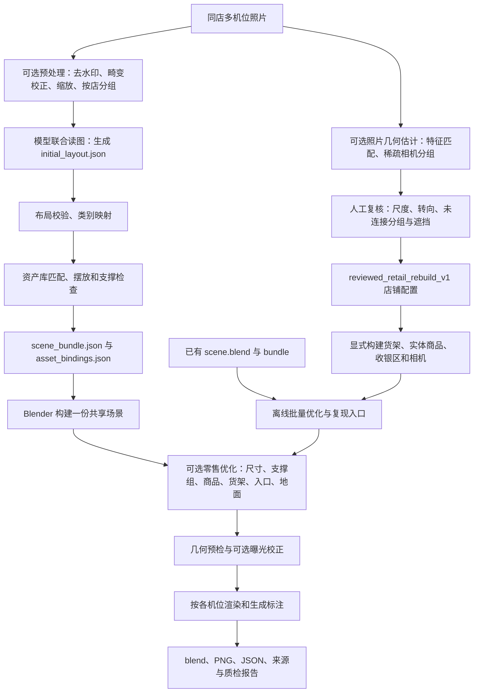
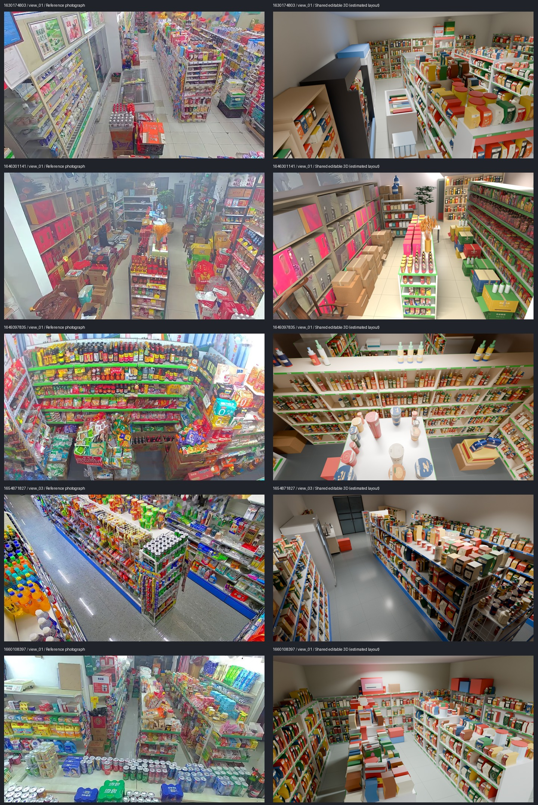

# Scene Factory：批量场景生产程序与 Demo 复现

> **自动批量生产的能力边界（2026-11-06）：** 正式入口已经支持照片分组、自动分析、资产匹配、共享场景构建、复审与预算内修复；本页 Demo 则包含人工调整的店铺坐标、相机与工程覆盖。Demo 的批量重放、复现通过，不等于未知店铺无需人工微调即可达到同等质量。通用零售细化配置不会自动修正全部布局错误。
>
> 无人微调生产应以冻结的通用程序、配置、资产库和预算，在未参与调参的店铺上验收；统计全部输入的自动完成率、零人工干预质量通过率、人工介入率，以及每家合格店的成本与耗时。任何人工修改布局、相机、商品面裁切或专店配置后的结果应单列。目前尚未给出这项盲测的通过率，不能用展示样本替代。

Scene Factory 把同一家店的多张监控照片转换成一个可编辑 Blender 场景，再从各个相机输出渲染和标注。模型负责理解照片并提出布局；资产选择、摆放、支撑关系、商品网格、渲染和质量检查由本地程序执行。

本次 Demo 覆盖 **5 家店、43 个机位**。优化目标是改善货架比例、陈列内容和可见结构，并让所有机位共享同一份真实 3D 几何。当前仍是照片驱动的近似重建，不能作为实测空间精度或逐 SKU 还原的证明。

**2026-11-06 更新：** 下文保留五店 layout v3 的历史记录。布局偏差最大的 1660108397 已另做转向布局与收银区重建，当前入口为 `reproduce_reviewed_shop.py`，默认采用 v11 配置。最新全机位对照、复现命令和未解决问题见 [转向布局重建与复现](15_1660108397转向布局重建与复现.md)。它是人工复核配置驱动的共享 3D 候选版，未标记为照片布局完全还原。

## 1. 从输入到交付



图中“已有场景”分支复用共享优化模块，但使用独立保存场景渲染器；它输出渲染和优化检查，**不生成新的完整数据集标注**。需要标注时应走 `generate_multiview.py` 正式入口，不能直接沿用旧图片对应的旧标注。

| 阶段 | 输入 | 输出与主要程序 |
| --- | --- | --- |
| 照片预处理 | 原始照片、店铺分组 | 处理后照片、`groups.json`；`tools/weidian_prep/` |
| 布局理解 | 同一空间的多机位照片 | `initial_layout.json`、初始 bundle；`scene_factory` 模型适配器 |
| 照片几何证据（可选） | 等尺寸、同店照片 | 稀疏点、相机分组、未注册机位、`needs_review` 报告；`estimate_photo_geometry.py` |
| 经复核的布局重建（可选） | 米制估计配置、商品面图集、相机参数 | 共享 `.blend`、占地检查、输入哈希；`build_reviewed_retail.py` |
| 资产选择 | 布局、`asset_catalog.json` | 实例绑定、尺寸/支撑/摆放报告；`library_selection.py` |
| 纹理准备 | bundle、来源照片、资产材质 | 纹理清单与图片；现有纹理准备阶段 |
| 共享建场景 | bundle、绑定、资产文件 | Blender 对象、命名相机；`generate_multiview.py` |
| 零售优化 | 共享场景、语义 layout、可选配置 | 修正后的商品/货架、`retail_refinement.json`；`retail_refinement.py` |
| 渲染交付 | 共享几何、各机位相机 | `scene.blend`、`rgb_view_*.png`、标注、来源记录 |
| 批量控制与复核 | 输入清单、配置、已有输出 | 完成/失败汇总、续跑状态、全机位对比 |

模型返回值只作为经过校验的数据使用。重跑照片理解可能产生不同布局；要复现已经验收的结果，应冻结布局、资产及优化配置，不重新请求模型。

## 2. 零售优化具体做了什么

优化在所有相机渲染之前执行一次。商品是网格和固定 UV，换机位不会换一套物体，也没有用面向相机的照片平面替代货架。

| 能力 | 实现方式 | 复用条件 |
| --- | --- | --- |
| 商品细化 | 识别已有商品材质/连通分量，生成瓶、袋、盒、杯形网格 | 能识别原资产商品面；未知拓扑保留并记录跳过 |
| 商品分类 | 类别/ID 推断，支持显式 `kind` 覆盖 | 推断是启发式；特殊陈列应配置 |
| 顶层补货 | 在检测到的水平顶板上生成实体商品，避开已有商品包围盒 | 显式启用 `top_stock`；并非自动恢复真实库存 |
| 货架尺寸 | 在货架本地坐标轴上恢复/覆盖尺寸 | 显式 `fixture_dimensions`，需要多机位复核 |
| 支撑组变换 | 依据 `support_id` 追踪传递依赖，商品随支撑物移动/缩放 | 有语义 layout；不要求恰好使用 Blender 父子关系 |
| 新碰撞拦截 | 检查变换前后 AABB 重叠和房间越界的增加 | 保守检查；已有重叠和精确网格碰撞不在其认证范围 |
| 视觉细节 | 米制地砖、价签条、可选金属网架、估计入口 | 按店显式配置，不能盲目给所有店加门/换货架 |
| 可复现随机性 | 店铺 ID、物体 ID 与固定种子决定商品变体 | 固定输入、算法和配置 |

`scene_factory/retail_stock_geometry.py` 提供共享商品网格；`retail_visual_detail.py` 生成地面和结构细节；`retail_refinement.py` 是正式生产与保存场景优化共同调用的入口。

### 本轮布局 v3

此前几家店的资产实际尺寸与布局估计值偏离，出现后墙货架高低不齐、岛台偏矮、柜台比例不一致。本轮新增本地轴尺寸修正，尤其防止旋转 90° 的长条货架把长度和深度互换；支撑物、下属商品以及派生 bundle 的位置/尺寸同步更新。

`configs/retail/demo_layout_v3.json` 在 visual v2 基础上增加三店尺寸配置：1630174803、1649397835、1660108397。1649397835 的前部岛台高度依据多机位人工复核调整，杯面陈列使用杯形商品。可能引入柜台、冰柜重叠的尺寸覆盖在小样阶段已移除，没有绕过检查。没有启用随机地面箱堆。

尺寸仍是照片解释值，不能把“恢复 target_dimensions_m”当作已恢复真实布局。房间宽深、相机姿态、后仓杂物、收银区细节和 SKU 仍有明显差距。

### 通用算法与店铺配置的边界

本轮新增的尺寸变换、支撑组、商品形状和批量检查均可复用。**Demo 中的手工参数不会自动推断到其余店铺**；特别是 1646301141 使用已人工重建的 v5 工程作为输入覆盖，复现该结果必须提供这份工程。它不是通用算法自动重建出来的。

## 3. Demo 输入、版本和效果

| 店铺 | 机位数 | 本轮输入与处理 |
| --- | ---: | --- |
| 1630174803 | 10 | 原始 demo_v3；统一部分货架尺寸与后墙货架高度 |
| 1646301141 | 8 | v5 专店工程覆盖；保留人工重建布局，应用通用细节 |
| 1649397835 | 12 | 原始 demo_v3；货架比例、前部岛台高度、杯形陈列 |
| 1654871827 | 3 | 原始 demo_v3；保留已验证的金属网架、地面及入口细节 |
| 1660108397 | 10 | 原始 demo_v3；柜台、墙架、岛架尺寸覆盖 |

最新版五店原图与优化后效果选摘：

**复核更正：1660108397 未通过照片布局一致性验收，不应视为优化成功示例。** 全十机位检查发现前后区、通道、冰柜/柜台与相机配合明显失配，详见 [该店布局复核](12_1660108397布局复核.md)。下图保留该店以展示当前失败状态。

该店后续独立版本见 [共享布局重建 v4 与复现入口](13_1660108397共享布局重建.md)。此处五店拼图仍对应原 layout v3，避免混淆批次。

更新后的 v11 将横向饮料架、后区零食通道、侧门和前区柜台纳入同一场景，并检查全部十个机位。见 [最新对照与限制](15_1660108397转向布局重建与复现.md)。本次仅重渲染该店，其余四店仍使用此前交付。



每家店全部机位的对比、与 visual v2 的直接对比以及机器可读指标放在 `demo/layout_v3/`。对比图保留失配区域，不能只用一个好看的机位代表全店。

全部机位对比：[1630174803](demo/layout_v3/1630174803/all_views_review.jpg)、[1646301141](demo/layout_v3/1646301141/all_views_review.jpg)、[1649397835](demo/layout_v3/1649397835/all_views_review.jpg)、[1654871827](demo/layout_v3/1654871827/all_views_review.jpg)、[1660108397](demo/layout_v3/1660108397/all_views_review.jpg)。

### 验收口径

- 渲染覆盖全部 5 店 / 43 机位，长边 1920px，Cycles 256 spp 上限，启用自适应采样与降噪。
- 各店的渲染前后几何摘要一致，源相机矩阵/焦距保留，网格坐标有限，新增变换通过 AABB 检查。
- 原图相关度、SSIM、亮度/饱和度误差属于图像指标；不能替代布局测量和多机位人工复核，也不保证每一项都上升。
- 本次没有重跑 494 家店；494 家结构评分是既有筛选结果。程序可批量执行与全量质量已达标是两件不同的事。

具体完成状态和指标以本页末尾的实测记录及输出 JSON 为准。

## 4. 一条命令复现本次 Demo

### 环境和数据

本机验证环境是 Python 3.12.14、Blender 5.2.0 LTS、macOS ARM64。安装仓库 Python 依赖及 Pillow、NumPy、SciPy；Blender 独立安装。脚本通过 `--blender` 或 `BLENDER` 指定可执行文件。

```sh
python3.12 -m venv .venv
.venv/bin/python -m pip install -e .
.venv/bin/python -m pip install Pillow numpy scipy
```

仓库不打包原始照片、资产库和大型 `.blend`。需要已有 `production_local` 数据，包括原 `demo_v3` 的 5 店、1646301141 的 `demo_v5_geometry` 工程和其引用照片/布局。冻结清单 `configs/retail/demo_replay_v3.json` 记录 58 个输入文件的相对路径、字节数及 SHA256，包含场景、bundle、语义布局和全部引用照片。

保存场景的 replay 不请求模型，也不重选资产。正式从布局重新构建时还需要对应资产库、绑定和纹理。

### 先检查，再执行

以下在仓库根目录执行；将 `PRODUCTION_ROOT` 改为本机生产目录。输出必须用独立新目录。

```sh
export PRODUCTION_ROOT="/path/to/production_local"
export BLENDER="/Applications/Blender.app/Contents/MacOS/Blender"

.venv/bin/python tools/batch/reproduce_demo.py \
  --production-root "$PRODUCTION_ROOT" --check-only

.venv/bin/python tools/batch/reproduce_demo.py \
  --production-root "$PRODUCTION_ROOT" \
  --out "$PRODUCTION_ROOT/demo_replay_layout_v3"
```

默认完整 1920/256 渲染。先检查低清效果时加 `--quality preview`，输出另一目录，使用 800/32。包装图集随仓库提供，不需要图片生成服务或 API 密钥。

脚本会校验冻结输入的哈希，记录配置、图集、代码摘要、Python、平台和 Blender 版本，自动应用 v5 来源覆盖。输入缺失/变化会直接失败；不要删除校验去强行复用不同批次。

**数据搬迁限制：**冻结 bundle 内的 `source_image` 仍是原始绝对路径。生产根目录参数可以选择外部数据位置，但不会偷偷重写这些来源路径；搬到另一台机器时需恢复原挂载路径，或重新准备并审核新的 bundle/清单。当前提供的是已验证的本机离线复现入口，不承诺任意目录迁移后一键即用。

### 断点续跑

重新执行同一命令，完成且指纹相同的店铺会显示 `resumed: true`。指纹包含源工程、bundle、layout、图集、优化代码、配置、机位、分辨率、采样和 Blender 版本。缺图或文件损坏时重跑该店；失败店不会阻断后续店。修改代码/配置/输入后使用新输出目录，避免混合结果。

`replay_receipt.json` 是复现收据；`batch_state.json` 是每店续跑状态。跨 GPU、Blender 构建或采样实现不能承诺 PNG 逐字节一致；本轮验证的是固定输入与共享几何、渲染参数的重放。

独立构建的两份输出可进一步用以下命令核对配置、来源、机位、商品数和世界几何摘要。右侧可以使用相同命令在另一新目录生成的结果；无渲染构建也可用于几何核验，但不证明渲染像素一致。

```sh
.venv/bin/python tools/batch/verify_retail_replay.py \
  --left "$PRODUCTION_ROOT/demo_replay_layout_v3" \
  --right "$PRODUCTION_ROOT/demo_replay_layout_v3_second" \
  --out "$PRODUCTION_ROOT/demo_replay_layout_v3/replay_verification.json"
```

## 5. 接入正式批量生产

### 新场景/重新建场景

`scene_factory/generate_multiview.py` 新增两个可选参数：

```sh
"$BLENDER" -b --factory-startup --python-exit-code 1 \
  --python scene_factory/generate_multiview.py -- \
  --spec /path/to/scene_bundle.json \
  --asset-catalog /path/to/library/asset_catalog.json \
  --asset-bindings /path/to/asset_bindings.json \
  --texture-manifest /path/to/textures/manifest.json \
  --retail-optimization /path/to/production_retail_config.json \
  --retail-layout /path/to/initial_layout.json \
  --output-dir /path/to/fresh_output \
  --max-edge 1920 --samples 256 --device AUTO
```

优化紧接共享建场景之后，先于几何预检、曝光校正和逐机位标注。修正后的 bundle 保存为 `optimized_bundle.json`，语义布局为 `refined_layout.json`。正式入口同步用于标注的对象位置和尺寸，并在每机位标注中记录新增入口/货架细节的世界包围盒。

已有两种上层入口也接好了转发：`tools/batch/render_demo.py --retail-optimization CONFIG`；`tools/batch/render_offline.py` 读取环境变量 `RETAIL_OPTIMIZATION=CONFIG`。后者仍沿用原参数 `PILOT CATALOG OUT [SHOP ...]` 和历史输出策略，使用全新输出目录。

这不是把优化默认开启到所有生产任务：批量启动器需要显式传入配置。对普通新店，先用只包含通用规则的 defaults；不要直接复制 Demo 的门体、移动、尺寸和特定对象 ID。生产配置中不存在的物体 ID 会导致失败，便于发现布局版本不匹配。

仓库提供 `configs/retail/production_defaults_v1.json` 作为通用起点：只开启已识别商品的形状/包装细化，没有 Demo 店铺 ID、入口、尺寸覆盖和货架移动，图集也是通用包装。它不会自动纠正未知店铺布局。可以将上面命令的优化配置替换成这份文件，先抽样验证，再为确有证据的店补充 `scenes.<店号>` 配置。

例如对复核过的某个货架，可在该店配置中加入 `fixture_dimensions: [{"id": "实际货架ID", "dimensions_m": [1.8, 0.8, 1.5], "evidence": "多机位复核说明"}]`；尺寸单位为米，依次是货架本地长、深、高。货架转向由原场景保持。类别覆盖使用 `fixtures.<实际货架ID>.kind`，支持 `mixed/snack/beverage/cup/household/gift/tobacco/preserve`；`preserve` 保留原商品，`enabled: false` 跳过该对象的商品细化。

### 已有场景批量升级

```sh
.venv/bin/python tools/batch/optimize_demo_batch.py \
  --source-root /path/to/saved_scenes \
  --out /path/to/new_batch \
  --config /path/to/production_retail_config.json \
  --edge 1920 --samples 256
```

输入目录内每个店铺文件夹须有 `scene.blend` 和 `scene_bundle.json`。不指定 `--shops` 时自动发现；可用 `--shops ID ...`、`--views view_01 ...` 做筛选。语义 layout 从 bundle 引用照片所在批次查找，缺失时无法使用需要支撑图的移动功能。

建议先跑少量店的全部机位，再冻结规则扩大批次；将不支持的资产、未知拓扑、尺寸冲突留在失败/跳过报告中，人工修正输入或配置，不能只看总出图数。

### 从照片开始的完整生产

现有主命令 `scene-factory run --config CONFIG --groups GROUPS` 负责模型读图和批量生成，`scene_factory/batch_guard.py` 管理预算账本、失败熔断和防重复付费。其准备步骤、资产扩库和历史结果详见 [项目全流程](06_项目全流程.md)。零售细化的验证入口是上述 Blender 参数或已接入的离线批量脚本；尚未给所有配置/调度器新增自动启用开关。

模型凭据只通过原运行环境配置，不放入复现收据、布局、文档或仓库。

## 6. 输出怎么用

```text
batch_output/
  replay_receipt.json           # 用 replay 入口时生成
  effective_config.json
  summary.json                 # 每店 complete/failed、耗时、续跑情况
  all_shops_review.jpg          # 原图/初始/本轮选摘
  SHOP/
    scene.blend                # 打包纹理的可编辑真实场景
    scene_bundle.json          # 原始基础结构加变换元数据；不是完整新增网格描述
    refined_layout.json        # 找到语义 layout 时生成
    rgb_view_01.png ...
    retail_refinement.json     # 商品数量、尺寸、移动、跳过项、限制
    optimization_config.json
    verification.json         # 几何摘要、相机、坐标、AABB 检查
    batch_state.json
    blender.log
    all_views_review.jpg
```

新增程序网格的权威交付是 `scene.blend`，不能只拿 `scene_bundle.json` 就假定能直接重建所有新细节。要从 bundle 再生成，应同时提供相同优化代码、配置和外部依赖；1646301141 的专店来源仍需单独保存。

正式生成器额外提供 `annotations_view_*.json`、汇总标注、`metadata.json`、`geometry_preflight.json` 和来源记录。保存场景升级分支不复制旧标注来冒充新标注。

### 效果复核与指标

```sh
.venv/bin/python tools/batch/evaluate_retail_batch.py \
  --source-root "$PRODUCTION_ROOT/weidian_full_runs/demo_runs/demo_v3" \
  --out "$PRODUCTION_ROOT/demo_replay_layout_v3"

.venv/bin/python tools/batch/review_retail_iteration.py \
  --previous "$PRODUCTION_ROOT/weidian_full_runs/demo_visual_v2_20261105/final_1920" \
  --current "$PRODUCTION_ROOT/demo_replay_layout_v3"
```

前者比较初始 Demo，后者比较上一轮 visual v2，生成全部机位三列拼图、`iteration_metrics.json`。SSIM/梯度结构分越高越好，亮度/饱和误差越低越好。保留下降机位，在几何/外观之间做明确取舍。

完成评估后可将效果图与检查记录打包进文档目录。脚本只接受全部店铺完成且验证通过的批次，不复制大型场景，也不执行网络发布：

```sh
.venv/bin/python tools/batch/package_retail_demo.py \
  --batch "$PRODUCTION_ROOT/demo_replay_layout_v3" \
  --out docs/weidian/demo/layout_v3 \
  --showcase-view 1654871827=view_03
```

`package_manifest.json` 记录文档素材的 SHA256。完整可编辑场景和全分辨率 PNG 保留在生产输出目录。

## 7. 代码与验证

| 文件 | 责任 |
| --- | --- |
| `tools/batch/reproduce_demo.py` | 固定输入校验、运行收据、5 店一键重放 |
| `configs/retail/demo_replay_v3.json` | 外部输入清单与质量档位 |
| `configs/retail/demo_layout_v3.json` | Demo 的可审查优化配置 |
| `tools/batch/optimize_demo_batch.py` | 店铺发现、指纹、失败隔离、续跑、拼图 |
| `tools/batch/optimize_retail_scene.py` | 保存场景的一次优化、多机位渲染、打包与一致性检查 |
| `scene_factory/retail_refinement.py` | 尺寸、支撑图、移动、商品替换与审计 |
| `scene_factory/retail_stock_geometry.py` | 瓶/袋/盒/杯等可编辑商品网格 |
| `scene_factory/retail_visual_detail.py` | 地面、入口、价签和网架 |
| `scene_factory/generate_multiview.py` | 正式建场景、预检、渲染和标注接入 |
| `tools/batch/estimate_photo_geometry.py` | SuperPoint / LightGlue / COLMAP 稀疏证据、缓存和需复核报告 |
| `tools/batch/build_reviewed_retail.py` | 显式米制估计配置构建共享货架、道具、墙段与相机；货架占地 SAT 检查 |
| `tools/batch/prepare_reviewed_atlas.py` | 按审查过的四边形展开单个商品包装面，保存来源哈希 |
| `tools/batch/reproduce_reviewed_shop.py` | 配置/代码/输入冻结，调用构建与现有批量渲染器，校验后续跑 |
| `tools/batch/verify_retail_replay.py` | 比较独立目录重建的输入身份、相机和世界几何摘要 |
| `tools/batch/package_reviewed_shop.py` | 全机位原图/历史/当前对照、完整指标与图片哈希清单 |

```sh
.venv/bin/python -m unittest discover -s scene_factory -p test_retail_refinement.py
"$BLENDER" -b --factory-startup --python-exit-code 1 \
  --python scene_factory/test_retail_dimensions_blender.py
```

新增 Blender 集成检查覆盖旋转 90° 货架的本地轴尺寸、没有 Blender 父子关系的商品跟随、bundle 与语义布局同步、配置不被验证过程改写。每店正式渲染还会保存前后几何哈希与相机保留检查。

开发期间被终止或检查失败的 `weidian_layout_v3_20261105/final_1920`、`checked_preview` 均是诊断输出，不能用作最终 Demo。有效交付使用独立目录 `weidian_layout_v3_20261105/validated_final`，避免与错误的小样混淆。

## 8. 本轮验证记录（2026-11-05）

- 6 项配置/支撑图/边界纯 Python 测试通过；5 项多机位渲染器和 9 项几何预检回归测试通过。
- 新增 Blender 集成检查通过，验证旋转货架、无父子关系的支撑商品、元数据同步、杯形商品包围盒和配置不被改写。
- 正式 `generate_multiview.py` 使用三店真实资产完整建场景，`--no-render` 输出 10 + 12 + 10 份标注；三店几何预检通过，32 份标注位置/尺寸与优化 bundle 一致，逐视图对象世界几何一致。这个检查没有重新渲染 PNG。
- replay 的 58 文件哈希检查通过；缺失输入的负向检查正确返回失败。
- 最终五店 43 张 PNG 全部完成，逐文件检查可解码且长边为 1920px；渲染设置为 256 spp 上限。首轮五店渲染累计 1533.8 秒，不含评估、独立重建与此前小样。
- 五店 `verification.json` 均通过；另一独立进程按相同输入重新构建后，五店有效配置、相机列表、商品数与世界几何摘要全部一致，见 [独立重建记录](demo/layout_v3/replay_verification.json)。
- 再次执行同一复现命令，五店全部 `resumed: true`，没有重新渲染，见 [续跑汇总](demo/layout_v3/summary.json)。

下表保留与上一轮 visual v2 比较的实测结果。结构分为梯度相关/方向组合分，SSIM 为相对原图的全机位均值，均不是米制布局精度。保留四位小数会隐藏极小波动。

| 店铺 | 机位 | 商品单元 | 结构分 v2 → 本轮 | SSIM v2 → 本轮 |
| --- | ---: | ---: | --- | --- |
| 1630174803 | 10 | 2752 | 0.0424 → 0.0364 | 0.0715 → 0.0598 |
| 1646301141 | 8 | 995 | 0.0398 → 0.0398 | 0.1076 → 0.1076 |
| 1649397835 | 12 | 3400 | 0.0172 → 0.0211 | 0.0350 → 0.0461 |
| 1654871827 | 3 | 2202 | 0.1047 → 0.1047 | 0.1745 → 0.1745 |
| 1660108397 | 10 | 3097 | 0.0225 → 0.0147 | 0.0082 → −0.0008 |

本轮杯面店的两项均值提高，1630174803 和 1660108397 下降，另两店基本持平。因此 **layout v3 是可复现的布局修正候选版，不是五店照片还原度全面提高的验收结论**。对生产质量有要求时，下降店应保留 visual v2 作为对照，继续复核房间宽深、相机和收银区，再决定采用哪个版本。没有将本轮配置默认推广到其余店铺。

原始 Demo 对照保存在 [baseline_metrics.json](demo/layout_v3/baseline_metrics.json)，上一轮对照保存在 [iteration_metrics.json](demo/layout_v3/iteration_metrics.json)。两种基线分别保存，避免把改善幅度混在一起。

机器可读的生产标注检查记录位于生产目录 `weidian_layout_v3_20261105/production_smoke/verification.json`。

## 9. 经复核配置接入批量生产（2026-11-06）

原自动布局明显错误时，可把照片几何估计作为证据，再把确认的空间关系写入店铺配置。照片估计会返回多个独立分组、未注册机位及未知尺度，不能自动把这些分组合成可靠的整店布局。1660108397 的标准估计形成两个分组，仍需人工确定前后区的连接与尺度。

通用构建器、实体货架/商品、柜台和桶盆、批量渲染、续跑、哈希校验均可复用；店铺的货架坐标、相机复核值、商品面裁切坐标需要单独配置。共享场景只构建一次，十个相机轮流渲染它；没有按机位摆不同物体。

```sh
PRODUCTION_ROOT='/Users/binfengzou/Documents/建模生成场景数据集/production_local'
.venv/bin/python tools/batch/reproduce_reviewed_shop.py \
  --production-root "$PRODUCTION_ROOT" \
  --out "$PRODUCTION_ROOT/replay_shop166_v11"
```

这条命令默认使用仓库中的 `shop_1660108397_review_v11.json` 与同名 refine 配置。`--preview` 使用 800px / 32 spp；默认使用 1920px / 256 spp。再次执行相同命令可续跑；输入、代码或参数改变后应指定新的输出目录。

其他店通过 `--shop`、`--source-root`、`--review-profile` 和 `--refine-profile` 传入自己的文件。构建结果通过现有 `optimize_demo_batch.py --source-override` 接入批量渲染，多个店的 prepared_source 可在同一个批次中使用；详见新文档的批量示例。

这个分支交付可编辑工程、RGB、构建与验证记录。`reviewed_mesh` bundle 不是原资产库的完整装配配方，权威几何在 `.blend`；当前分支没有生成一套新的深度、实例、检测或分割标注。需要训练数据标注时应单独接入导出并核验，不能沿用旧图的标注。
