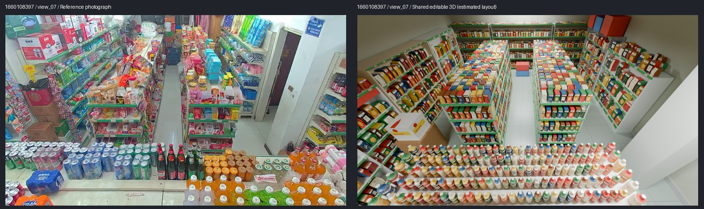

# 1660108397：共享布局重建 v4

这是针对上一轮布局复核失败的继续修正，不是照片级还原完成的声明。所有十个机位共享同一套可编辑几何，没有按机位换家具，也没有使用整张照片作为场景平面。

## 实际修改

- 后区四组岛架重建为实体层板、立柱、绿色价签条、双侧商品和端头商品；去掉原资产大片封闭端板。左右架中心改为 −0.78m / +0.78m，本地深度各 0.78m，目标架体净距约 0.78m。后段缩短，为反向机位保留后端通行区。
- 前区饮料架增加横向陈列，透明门冰柜重建为柜壳、门玻璃及内部实体饮料。部分前区对象的左右关系作为显式人工配置修正，保持支撑组一起变换。
- 增加共享横梁和墙垛。侧门洞、完整后区家居用品仍未恢复，不能把这版建筑结构称为完整复原。
- 调整十个相机；01、07、09 使用人工估计的三维架角/二维图像点拟合，其余为人工估计。拟合点、残差与边界警告存于 `configs/retail/shop_1660108397_landmarks_v4.json`。07 的焦距、09 的参数仍碰到拟合边界；01 拟合后因天花板约束降低过高度，保存的拟合残差不代表最终相机误差。不能当作标定结果。
- 新增场景准备阶段的相机房间边界、非有限网格、变换前后 AABB 检查；现有渲染阶段继续检查共享几何不变和相机不被逐视图修改。

## 一条命令复现

在仓库根目录运行，数据依赖与此前 Demo 一样，包含原 `demo_v3/1660108397`、对应 `initial_layout.json` 及引用照片。仍需原 bundle 的绝对照片路径可用。

```sh
.venv/bin/python tools/batch/reproduce_reviewed_shop.py \
  --production-root /path/to/production_local \
  --out /path/to/new_reviewed_shop_run
```

默认 1920px / 256 spp 上限；低清验证加 `--preview` 并使用另一输出目录。重复相同命令校验收据及准备场景哈希后续跑；修改配置、代码、数据或质量档位必须换目录。该入口不请求模型或图片生成服务。

程序先运行 `prepare_reviewed_scene.py`，再通过 `optimize_demo_batch.py --source-override` 接入已有批量生产控制。批量入口优先读取准备场景旁的 `initial_layout.json`，防止错误使用照片批次中的旧布局。

配置与代码：

- `configs/retail/shop_1660108397_review_v4.json`：相机、架体替换、建筑块、前区变换。
- `configs/retail/shop_1660108397_refine_v4.json`：保留通用商品/材质细化，跳过已重建架体，防止重复生成。
- `scene_factory/reviewed_retail_fixtures.py`：可复用货架/冰柜构造器，固定种子与 UV。
- `tools/batch/prepare_reviewed_scene.py`：只写新目录，保存原相机、替换记录、移除的旧支撑商品、碰撞检查、源文件及代码哈希。

这是**保存场景批量升级分支**，不能只凭修改后的 bundle 自动重建所有新网格。权威结果是 `scene.blend`；完整重建须同时运行准备脚本和配置。本次没有为该准备分支生成新的数据集标注，不应沿用旧标注，也不宣称这份专店配置能自动适用于其他店铺。

## 输出与复核

```text
new_reviewed_shop_run/
  replay_receipt.json
  prepared_source/
    scene.blend
    scene_bundle.json
    initial_layout.json
    preparation_profile.json
    preparation_report.json
  renders/
    summary.json
    1660108397/
      scene.blend
      rgb_view_01.png ... rgb_view_10.png
      verification.json
      retail_refinement.json
```

本机本轮输出：`production_local/weidian_shop166_v4_20261105/replay_final/`。`source_01` 至 `source_07`、`preview_*` 为开发小样，不能混当最终输出。

最终全十机位对比和实测结果见本页下方。布局准确性必须单独验收；能重建、能续跑、没有新增 AABB 重叠，不代表原图布局已经正确。

## 本轮结果（2026-11-05）

十个机位均完成 1920px / 256 spp 上限渲染，累计渲染批次耗时 388.4 秒。准备阶段 11 个架体/冰柜替换生成 4485 个商品单元；后续通用细化另生成 1321 个商品单元。后一个数字单独出现在 `retail_refinement.json`，不代表整场商品总数，也不是原图库存数量。



[查看完整十机位：原图 / layout v3 / 本轮](demo/shop166_v4/1660108397/previous_vs_current.jpg)。不能用这张选摘代替全机位验收。

| 原图对照指标（十机位均值） | layout v3 | 本轮 |
| --- | ---: | ---: |
| SSIM（高为好） | −0.0008 | 0.0274 |
| 梯度结构分（高为好） | 0.0147 | 0.0133 |
| 亮度误差（低为好） | 14.643 | 17.397 |
| 饱和度误差（低为好） | 0.0598 | 0.0973 |

SSIM 提高，但结构均值略降、亮度与饱和误差增加；结构分提高的是 01、03、07、09 四个机位。05/06 前区收银关系、10 的墙垛遮挡、04 后区家居用品仍明显失配；01/07 的架端位置和横向饮料陈列更接近，但通道及包装仍非真实复原。**本轮是局部结构改进，尚未通过全店照片布局一致性验收。** 因此未替换五店总 Demo，也未将这份专店配置作为其他店默认规则。

验证结果：

- 10 张 PNG 均可解码，长边 1920px；保存场景几何不随机位改变。
- 准备阶段 AABB 增量检查通过；这不覆盖全部精确网格碰撞或建筑体穿插。
- 用同一准备场景另起进程独立应用细化，配置、机位、世界几何摘要和商品数一致，见 [重建核验](demo/shop166_v4/replay_verification.json)。此核验没有从原始照片重跑模型，也不证明 PNG 逐字节一致。
- 同一复现命令再次执行返回 `resumed: true`，见 [续跑汇总](demo/shop166_v4/summary.json)。
- 6 项原配置测试通过；新增 Blender 检查验证货架网格确定性、反射变换后重建重置姿态、冰柜直立与高度范围。

[机器可读图像指标](demo/shop166_v4/iteration_metrics.json)。修改配置后必须使用新输出目录，保留旧结果作为失败/退化对照。
