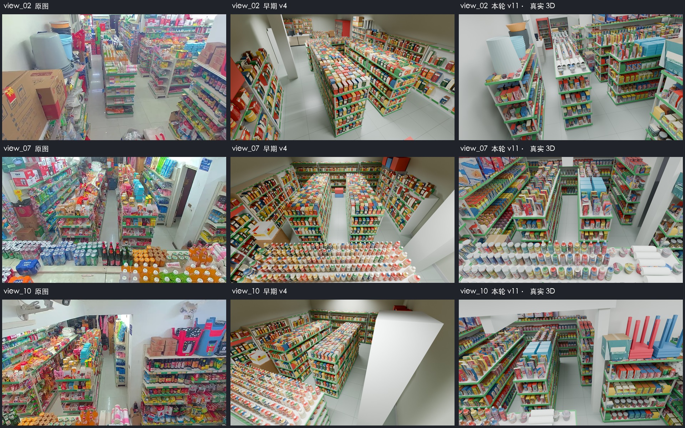
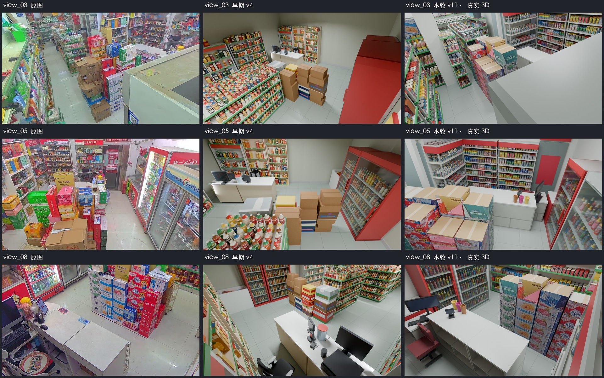

# 1660108397：转向布局、收银区重建与批量复现

2026-11-06。本次交付为 **v11 共享 3D 候选版**。后区横纵货架关系与收银区的主要物体摆放比 v4 明显接近照片，但未达到整店照片布局一致性验收。重点仍是可编辑、同场景多机位与可复现，商品形状和库存不是逐 SKU 重建。

## 1. 这次改了什么

- 把饮料架改为横向排列，后区两列零食架沿另一方向延伸；收银区位于侧翼。此前将所有货架解释为同一条纵向通道，会造成多个机位同时错误。
- 重建墙段、横梁、立柱、侧门口及对应货架，保留同一组世界坐标下的桶盆、凳子和纸箱。
- 重建前区转角货柜、柜台、电脑侧桌、椅子和两列纸箱。第 08 机位按四个桌面角点估计相机，修正电脑居中、桌面方向不对的问题。
- 商品面使用照片中独立包装的固定 UV；新增纸箱面展开配方和来源哈希。没有将整张照片放到背景平面上。
- 18 个货架/冰柜、91 个道具和 26 个建筑段由配置构建。所有十个相机共用这些对象，不在渲染循环里改变几何。

原图、v4 与 v11 的主要通道对照：



收银区对照，包括仍有偏差的视角：



[全部十机位对照](demo/shop166_v11/all_10_comparison.jpg) · [与 v10 的直接对照](demo/shop166_v11/previous_vs_current.jpg)

## 2. 哪些来自照片证据，哪些仍是估计

SuperPoint / LightGlue 匹配和 COLMAP 稀疏估计支持后区 01、02、07、10 的相对关系。另一个反向模型通过 5 条共同轨迹提供 09 的候选姿态。两条轨迹连接出的 04 姿态在画面复核中失败，已经拒绝，没有把小残差当作正确布局的证明。

收银区 03、05、06 能形成独立分组，但无法可靠连接到后区。v11 的 03 采用经复核的局部相对姿态候选；05、06 保留独立复核姿态。08 用桌面四角和估计桌面尺寸解姿态。所有采用的参数均写入 review 配置；照片估计不是渲染复现时必须重跑的步骤。

| 证据或检查 | 已知结果 | 不能据此得出的结论 |
| --- | --- | --- |
| 标准照片估计重跑 | 两个分组：01/02/07/10 和 03/05/06；04/08/09 未注册 | 十个机位已经自动统一到可靠米制坐标 |
| 后区稀疏拟合 | 标准重跑 545 个点，平均重投影残差约 1.04px | 货架位置、通道宽度具有相同精度 |
| 收银区标准重跑 | 302 个点，平均重投影残差约 1.44px | 与后区的连接、尺度已经恢复 |
| 尺度锚点 | 后区端架宽 0.60m、顶板高 1.32m，均为照片估计 | 实测平面图或测量级重建 |
| 08 桌面拟合 | 四个人工角点，平均像素残差约 9.55px | 整张照片或其他物体均已对齐 |
| 固定家具占地检查 | 18 个货架/冰柜及 4 个柜台/侧桌的旋转矩形 SAT 检查；修正侧桌与柜台重叠 | 所有道具、墙体与商品的精确网格碰撞均已验证 |

标准估计记录：[photo_geometry_report.json](demo/shop166_v11/photo_geometry_report.json)。局部探索模型与标准重跑的点数并不完全相同，文档不混用它们的结果。小样与失败拟合保留在生产目录中。

## 3. 复现当前结果

在仓库根目录执行。渲染依赖现有 Python 环境、Pillow / NumPy / SciPy 和 Blender；照片估计的 torch / LightGlue / pycolmap 不是渲染依赖。

```sh
PRODUCTION_ROOT='/Users/binfengzou/Documents/建模生成场景数据集/production_local'
.venv/bin/python tools/batch/reproduce_reviewed_shop.py \
  --production-root "$PRODUCTION_ROOT" \
  --review-profile configs/retail/shop_1660108397_review_v11.json \
  --out "$PRODUCTION_ROOT/replay_shop166_v11"
```

默认 1920×1080、Cycles 256 spp 上限、自适应采样与降噪。输出目录包含：

```text
replay_receipt.json                 输入、配置、代码、Blender 版本哈希收据
prepared_source/scene.blend         配置构建出的共享工程
prepared_source/preparation_report.json
renders/1660108397/scene.blend       渲染交付工程，纹理已打包
renders/1660108397/rgb_view_01.png … rgb_view_10.png
renders/1660108397/verification.json
renders/summary.json
```

当前正式输出在 `production_local/weidian_shop166_v11_20261106/validated_final/`。`preview_a` 至 `preview_h`、相机候选、失败目录均是诊断材料；`reproducible_final` 是侧桌修正前的中间版，不是最终交付。

再次执行相同命令会核对输入及 prepared_source 再续跑；改变配置、代码、纹理或渲染参数，需要新的输出目录。独立重建验证可以降低分辨率和采样，比较的仍是同一份世界几何与相机：

```sh
.venv/bin/python tools/batch/reproduce_reviewed_shop.py \
  --production-root "$PRODUCTION_ROOT" \
  --out "$PRODUCTION_ROOT/replay_shop166_v11_check" --edge 480 --samples 16
.venv/bin/python tools/batch/verify_retail_replay.py \
  --left "$PRODUCTION_ROOT/replay_shop166_v11/renders" \
  --right "$PRODUCTION_ROOT/replay_shop166_v11_check/renders" \
  --out "$PRODUCTION_ROOT/shop166_v11_rebuild_verification.json"
```

这项检查验证配置、来源身份、相机与世界几何摘要一致，不保证 PNG 字节完全相同，也不认证照片还原精度。

包装面可以单独由配方重新生成，记录四边形、来源照片 SHA256 和图集 SHA256：

```sh
.venv/bin/python tools/batch/prepare_reviewed_atlas.py \
  --recipe configs/retail/shop_1660108397_atlas_v11.json \
  --source-root "$PRODUCTION_ROOT/weidian_full_runs/weidian_gpt61sol_full_20261030/1660108397/sources" \
  --out "$PRODUCTION_ROOT/rebuilt_package_faces.png"
```

配方只选取单个包装面；其余图块继承仓库中冻结的 v10 基础图集。原照片的模糊和光照烘焙在裁片中仍然存在。

原图对照与指标也可以通过通用脚本重新生成；下面的命令把两个历史基线都保留下来：

```sh
.venv/bin/python tools/batch/package_reviewed_shop.py \
  --current "$PRODUCTION_ROOT/replay_shop166_v11/renders/1660108397" \
  --baseline "$PRODUCTION_ROOT/weidian_shop166_v4_20261105/replay_final/renders/1660108397" \
  --previous "$PRODUCTION_ROOT/weidian_shop166_v10_20261106/reproducible_final/renders/1660108397" \
  --out "$PRODUCTION_ROOT/shop166_v11_comparison" \
  --labels '早期 v4' '本轮 v11' '上一轮 v10' \
  --group key_comparison=view_02,view_07,view_10 \
  --group checkout_comparison=view_03,view_05,view_08 \
  --preview-views view_07 view_08
```

## 4. 接入其他店和批量任务

通用代码不按该店 ID 分支。每店准备自己的 review/refine JSON、图集及 source bundle，再通过 `--shop`、`--source-root` 和配置参数执行相同入口。`reviewed_retail_rebuild_v1` 配置包含房间包络、建筑段、货架/冰柜、道具、相机、灯光和校准说明。

构建好的多个工程可直接交给已有批量控制器：

```sh
.venv/bin/python tools/batch/optimize_demo_batch.py \
  --source-root "$PRODUCTION_ROOT/weidian_full_runs/demo_runs/demo_v3" \
  --shops 1660108397 \
  --source-override "1660108397=$PRODUCTION_ROOT/replay_shop166_v11/prepared_source" \
  --config configs/retail/shop_1660108397_refine_v11.json \
  --out "$PRODUCTION_ROOT/reviewed_batch" --edge 1920 --samples 256
```

批次包含更多店时，在 `--shops` 增加店号、为每个已重建店增加 `--source-override 店号=prepared_source`，并将各店的设置合并到 config 的 `scenes`。此命令每店失败隔离、保存指纹与续跑状态。reviewed 场景的货架应在 refine 中禁用二次商品替换，以保留已经构建的陈列。

可选照片证据阶段同样支持多店：

```sh
.venv/bin/python -m pip install -r requirements-photo-geometry.txt
.venv/bin/python tools/batch/estimate_photo_geometry.py \
  --source-root "$PRODUCTION_ROOT/weidian_full_runs/demo_runs/demo_v3" \
  --shops 1660108397 --focal-px 700 \
  --out "$PRODUCTION_ROOT/photo_geometry_review"
```

保存特征缓存、输入与库版本收据、稀疏分组和需复核报告。当前估计器要求同店照片等尺寸、共享内参假设；`--focal-px` 是初始化值。多组分离、未知尺度或未注册机位必须继续复核，不能直接当作生成布局。

这个分支已经复用批量渲染与质量记录，但**尚未为新网格导出完整深度/实例/检测/分割标注**。`.blend` 是真实几何的权威文件，bundle 的 `reviewed_mesh` 不能直接替代原资产库装配配方。

## 5. 验证与剩余偏差

- 10 张 1920×1080 PNG 完成，256 spp 上限，正式渲染约 277.0 秒；另一独立进程从配置重新构建全部十机位（480px / 16 spp），世界网格摘要及相机参数完全一致。见 [独立重建记录](demo/shop166_v11/rebuild_verification.json)。
- 同命令续跑返回 `resumed: true`；图集按配方重新生成的 SHA256 一致。见 [续跑记录](demo/shop166_v11/resume_summary.json)、[图集来源](demo/shop166_v11/package_faces.json)。
- 固定家具占地检查覆盖 22 个对象并通过；5834 个程序计数的商品单元跨机位不变。`stock_units: 0` 表示后续 refine 阶段没有再次替换商品；实际已有商品数在 `physical_stock_units`。
- 6 项配置/支撑图测试、3 项独立重建比较测试、Blender 货架确定性与冰柜方向检查通过；新增侧桌/柜台重叠的负向检查通过。
- 中间版首轮渲染曾在 Blender 内核编译阶段异常退出；保留崩溃日志，重试完成。最终 `validated_final` 的完整运行正常完成，未复用失败状态作为成功结果。

图像梯度分均值为 **v4 0.0133 → v10 0.0677 → v11 0.1077**。相对 v4 为 10/10 提高，相对 v10 为 8/10 提高；04 和 05 相对 v10 下降，幅度与逐机位结果均保留。此分数描述图像的粗结构相关性，不是还原百分比，也不是布局测量精度。

| 机位 | v4 | v10 | v11 |
| --- | ---: | ---: | ---: |
| view_01 | 0.0249 | 0.0600 | 0.0603 |
| view_02 | 0.0017 | 0.1494 | 0.1538 |
| view_03 | 0.0471 | 0.0513 | 0.1477 |
| view_04 | 0.0553 | 0.1155 | 0.1149 |
| view_05 | -0.0393 | 0.0346 | 0.0334 |
| view_06 | -0.0362 | 0.0470 | 0.0911 |
| view_07 | 0.0527 | 0.0843 | 0.0843 |
| view_08 | 0.0098 | -0.0140 | 0.2327 |
| view_09 | 0.0454 | 0.0725 | 0.0809 |
| view_10 | -0.0283 | 0.0764 | 0.0774 |

[原始指标 JSON](demo/shop166_v11/comparison_metrics.json) · [最终场景检查](demo/shop166_v11/verification.json) · [构建检查](demo/shop166_v11/preparation_report.json)


主要限制：04 的中间货架遮挡、家用品区比例仍与原图不一致；05/06 的柜台与柜门关系、03 的前景冰柜占比仍需改善；商品陈列过于规整，部分货物形状和数量不同。08 的桌面和电脑方向改善较大，但侧柜遮挡及纸箱高度仍有差异。不能只挑选 08 或某个后区机位作为整店通过的证明。

完整批量程序背景、五店历史批次与正式标注入口见 [批量场景生产程序介绍](11_批量场景生产程序介绍.md)。本次没有重跑其余四店或 494 店全量数据，也没有将这家店的手动坐标默认推广到其他店。
