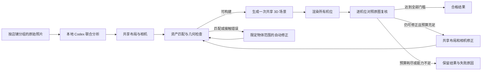

# 从多机位照片到共享三维场景

生产单元是一家店的完整照片组。每家店只构建一套几何、材质和照明，各机位使用独立相机观察同一个三维场景。新店的输入是照片清单、资产库和统一生产配置；生产入口拒绝逐店坐标、相机配置及预制 Blender 工程覆盖。

## 生产链路

### 1. 照片组与联合理解

程序保留每张照片的来源、机位 ID、方向和尺寸。模型同时读取同店照片，识别店铺边界、相连通道、货架与冷柜、收银区、支撑关系和相机朝向。输出是有边界约束的 JSON 数据，不执行模型生成的代码。

本地 Codex 使用本机已配置的模型及登录方式。分析、修正和复核分别记录请求、输入哈希、原始响应与完成状态。中断后可恢复已完成的响应，不把残缺响应视为成功。

### 2. 资产选择与几何检查

选择器根据物体类别、测量尺寸、放置方式及可用支撑面匹配资产。统一规则检查落地接触、支撑覆盖、物体重叠、建筑结构相交和房间边界。缺失的物体不会为了通过检查而被悄悄省略。

资产匹配修正仅允许更新出错物体、相关支撑组及涉及的建筑构件。房间、机位以及无关物体保持原值。允许在同一范围内补充照片推断的货架和冷柜参数，完成后重新检查整店。

### 3. 可编辑的货架与商品

照片推断的尺寸、层数、框架颜色和商品类别驱动公共参数化生成器。长货架沿任一水平轴均可生成；坐标变换保持世界占地不变。靠墙货架与中央货架依据共享建筑的位置关系选择背板形式。

明确识别为入口玻璃的物体使用公共实体玻璃生成器，按照片估计尺寸生成玻璃、框架和把手。导入用的临时资产与最终参数化几何在记录中分开标注，不把临时资产视为对实物的匹配证明。

商品由可编辑网格与固定 UV 包装构成。包装图集和生成规则对所有店铺一致，不把原始照片贴成整面墙，也不在切换相机时移动几何。资产库提供的支撑关系需要保留时，程序保留测量过的框架。

商品类别、尺寸与包装均可能近似。几何密度和对象数量只说明生成规模，不能用作布局正确或照片级真实感的证明。

### 4. 相机拟合与全机位输出

视觉修正可提供原图中的物体角点。程序在同一套三维对象上拟合相机位置、方向、焦距与滚转，并记录投影误差。角点不足、分布狭窄、求解不收敛、触及约束或误差过大时，程序拒绝应用拟合。

相机计算已与 Blender 的独立投影实现核对，覆盖横幅、竖幅与不同滚转角度。数学投影一致并不意味着模型识别的角点一定正确，因此拟合后的场景仍需重新渲染和逐机位复核。

### 5. 质量门槛与结果分流

完成渲染和通过质量验收是两个状态。复核同时检查构图、布局、几何、材质、照明和真实感；各机位必须逐一检查，不能用最佳视角替代整店质量。

当前程序的自动接受门槛是各机位各维度至少 85 分、真实感至少 90 分，且不存在主要问题、阻塞问题、资产缺口或技术警告。这些分数是模型评估，不是经过标定的测量精度。

| 结果 | 含义 |
| --- | --- |
| accepted | 本次任务通过全部自动门槛 |
| needs_review | 已有可检查结果，但仍未通过自动验收 |
| generated_unreviewed | 生成完成，尚未执行视觉验收 |
| failed | 分析、资产匹配、构建或验证失败，保留原因 |
| paused / interrupted | 资源保护或中断，可按记录恢复 |

## 批量运行

照片组被分配为独立店铺任务。店铺并发、模型并发和 Blender 并发分别控制；默认生产配置为 3 个店铺任务、2 个模型调用、1 个 Blender。每店有独立修正与请求预算，运行前检查磁盘空间。

当前本地 Codex 配置限制每店最多 8 次模型请求、3 轮修正，不设置可强制执行的 token 总量上限。请求数、耗时和质量结果可以直接统计；未取得可靠的模型用量账单时，不据此推算精确费用。

每批冻结程序、通用配置、包装图集和输入清单，并记录软件环境。原始模型响应只有在照片、提示、模型和响应格式等绑定证据一致时才可复用；资产选择、构建及视觉复核仍要执行。

批次报告以全部输入店铺为分母，保留失败与未完成任务。对照图将原始照片与相应机位渲染并排显示；过程诊断图另有明确标记。已渲染店数、完整机位输出数和通过验收店数分别统计。

## 展示材料的取图原则

面向业务的效果文档应使用所声明生产版本实际产出的图片，并与批次记录对应。逐店修改的旧展示图不能代替新店自动生产的验证。全自动达到某一展示效果，必须由同一冻结流程在完整样本上实际运行并通过验收后才能宣称。

具体批次的结果、分母、耗时、模型请求数与质量结论以该批报告为准；程序功能和单元测试通过不等于所有店铺均能达到目标效果。
