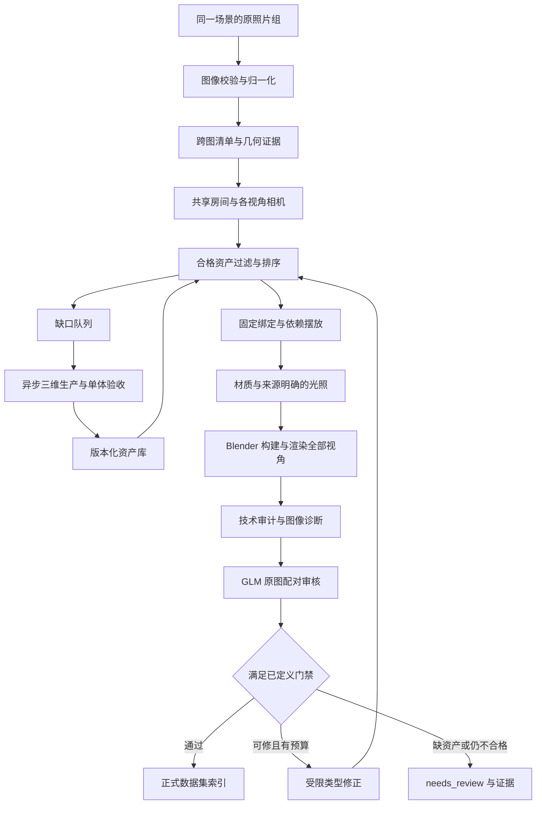

# 参考 HARMONY 优化照片到批量 Blender 场景的方案

本文对照 HARMONY 的实际源码和当前 Scene Factory。目标是提高照片还原质量，同时保留可替换模型 API、分组多图、可续跑和只让通过验收的场景进入正式数据集的能力。

最值得借鉴的是：**先取得图像与几何证据，再按依赖关系恢复房间和物体，最后通过原图对比修正。** 单靠视觉模型一次写出完整场景 JSON，再提高渲染采样，无法补回错误的相机、物体轮廓、支撑关系和材质。

推荐采用“合格资产库优先，特殊物体按需补库”的混合方案。不要把每张照片的每件物体都重新生成一遍，也不要把 HARMONY 的所有阶段原样搬入当前程序。两者都会增加成本和故障点，而不自动保证更真实。

## 1. 分析范围与事实边界

源码基准是 [ShufanSun/harmony-release](https://github.com/ShufanSun/harmony-release)，本地核对的提交为 `982556b77805da8ef812545843870325f124346c`。下文 HARMONY 链接固定在该提交，避免未来代码变化造成歧义。

- HARMONY 的公开主入口是**单张参考图**，输出独立房壳、家具、墙挂、装饰等网格及组装场景。它不是已经完成的任意多图批处理产品。
- 当前主入口的 `ALL_STAGES` 有 30 个阶段。部分旧说明中的阶段数量不能代表实际执行路径。本文按功能归并，避免把“30 个阶段”误解为必须发出 30 次模型请求。
- HARMONY 结合视觉语言模型、深度/相机模型、分割、图像编辑和 Hunyuan3D。视觉语言模型可以用兼容 API 替换；一个 GLM API 不会同时替代深度、分割和三维生成工具。
- 本文完成的是源码分析与改造设计。本轮代码工作的直接范围是**可选的自动资产绑定、批处理接入、绑定感知的审核/返修，以及资产输入冻结与缓存失效**。深度重建、分割、外观检索、专用三维生成服务和精确网格碰撞，均不能据此宣称已经实现。
- 当前照片重建仍存在尺度与隐藏面不确定性。资产包契约通过、Blender 渲染成功、视觉模型建议接受，是不同层次的结果。

源码：[README](https://github.com/ShufanSun/harmony-release/blob/982556b77805da8ef812545843870325f124346c/README.md)、[阶段注册与调度](https://github.com/ShufanSun/harmony-release/blob/982556b77805da8ef812545843870325f124346c/main.py)。

## 2. HARMONY 实际做了什么

| 功能阶段 | 主要输入 | 实际工具与处理 | 主要输出 | 可以借鉴的作用与限制 |
| --- | --- | --- | --- | --- |
| 房间与相机初解 | 原照片 | VLM 分析房间、墙面、相机；构建初始房壳 | `floorplan_analysis.json`、`walls.obj`、`camera.json` | 先固定空间基准。语言估计仍可能错，不能当米制真值 |
| 几何证据与修正 | 照片、初始房壳 | VGGT 深度、法线、点云、相机信息；Manhattan 主方向与墙面对齐；房间几何修正 | 修正房壳、`camera_vggt.json` 等 | 用图像几何约束相机和房间，减少纯口述布局；玻璃、镜面、遮挡、非直角房间仍可能失败 |
| 空房与表面纹理 | 原照片、房壳 | 去除前景物体、表面透视校正、纹理清理；按材质描述进行图像编辑 | 空房参考、墙/地/顶纹理 | 图案、颜色和尺度更接近照片；生成纹理仍可能补造，且可能残留烘焙阴影 |
| 墙挂物体 | 照片、墙面/相机 | 检测、SAM2 分割、遮挡补全；窗、门、画框使用纹理平面；其他物体走三维生成 | 物体 GLB、贴图、墙面放置 | 先解决建筑附着物，便于后续摆放与光源收集；纹理平面只在一定视角有效 |
| 家具 | 分割物体、房壳、相机 | 图像补全、Hunyuan3D、尺寸/朝向/位置分析；地面射线与深度、投影轮廓辅助修正 | 家具网格、摆放变换、材质 | 具体网格轮廓优于统一方块；薄结构、隐藏面与尺寸仍需验证 |
| 装饰和桌面小物 | 已放置家具、原图 | 再查漏检小物、分割、补全、三维生成，放在已有支撑物上 | 小物体及支撑摆放 | 先大后小，降低漂浮和漏物；支撑关系不能只靠自然语言 |
| 顶部物体 | 原图、当前房间 | 单独分割、补全、生成、材质与顶部摆放 | 顶灯等独立物体 | 保留灯具外形，并为光照阶段提供来源 |
| 光照 | 窗/灯具记录、原图 | 收集光源、估计光照、修改发光材质，预览后请求参数增量 | `lights.json`、`sources.json`、迭代图与 `refine_log.json` | 将可见灯具与照明关联；部分中间预览是合成/栅格近似，不能代替最终路径追踪验收 |
| 组装与查漏 | 全部网格与变换、原图 | 组装可编辑 GLB；末端比较原图与结果，报告缺失对象 | `scene_full.glb`、缺失报告 | 防止局部阶段都成功但整场景漏掉关键对象；发现问题不等于自动完成修复 |
| 离线基准评估 | 参考图、渲染；部分场景有几何真值 | N-CLIP、像素误差、LPIPS；有真值时 Chamfer/F-score | 汇总指标、比较图 | 可量化相对改进；不能直接把未校准指标当单场景合格证 |

其核心不是某个更长的提示词，而是分层处理、不同工具交叉约束，以及保留中间证据。

## 3. 为什么当前结果“假”：应按什么顺序修

照片级观感首先受大结构控制。按收益优先级，建议依次处理：

1. **相机与透视**：相机高度、视场角、朝向、倾斜和取景是否一致。房间与家具都类似，但相机不对，整幅图仍会像另一个空间。
2. **房间与大物体布局**：门窗位置、墙长、顶高、家具数量、比例、前后遮挡是否一致。错误布局不能用更好的贴图遮住。
3. **物体轮廓与支撑**：椅背、桌腿、柜体、床架是否与照片同类；是否落地、贴墙、放在正确支撑上。接触阴影缺失有时是几何悬空造成的。
4. **材质结构与纹理尺度**：塑料、覆膜板、织物、金属是否区分；木纹方向、板缝、织纹大小是否合理；粗糙度是否全部一样。
5. **照明与成像**：灯源位置和大小、亮暗分区、色温、遮挡、间接光、曝光和高光压缩是否接近原图。
6. **使用痕迹和小细节**：磨损、轻微污渍、杂物、缝隙、微小不规则。只有照片提供依据时才恢复；添加随机旧化不会自动增加还原度。

“太新”可以是其中一个原因，但通常不是首要原因。资产过于规整、粗糙度统一、缺少微倒角、用错误木纹覆盖所有桌面、顶灯与补光抬平所有暗部，都比是否加灰尘更显眼。

对已提出的“太亮、柔光过头”问题，正确目标是参考照片中的办公室顶灯、略暖、有明暗层次。不能将全局环境光、曝光或光源面积无限增加作为通用修复。

## 4. 优先借鉴一：以几何证据校正房壳和相机

HARMONY 先由 VLM 提出初解，再用 VGGT 深度与 Manhattan 方向等信息修正房壳和相机。家具阶段也优先读取实际 `walls.obj` 的尺寸，避免分析 JSON、放置器和渲染器使用不同房间宽度。

当前程序保留一个共享场景和多张相机，这一点应继续保留。需要补上的不是另一个“猜尺寸”提示词，而是一个可选几何证据层：

| 证据 | 适合约束什么 | 不应被误用为什么 |
| --- | --- | --- |
| 图像尺寸、EXIF、有效焦距 | 相机内参的先验、方向归一化 | 没有 EXIF 时推断出唯一真实焦距 |
| 墙/地/顶分割、线段与消失点 | 地平线、滚转角、主方向、房壳投影 | 默认所有空间均为直角盒子 |
| 单目深度和法线 | 前后关系、平面一致性、相机/布局的相对修正 | 直接取得可靠的米制深度 |
| 多图匹配点和相对位姿 | 判断相机方向关系、共享物体与多视图一致性 | 低重叠、重复家具或镜像照片也必然匹配成功 |
| 已知尺度物体或实测尺寸 | 提供绝对尺度锚点 | 把“常见门宽”“典型床长”记成实测 |
| 物体 mask 和 bbox | 可见区域、投影轮廓、取景位置 | 将被遮挡或被画面裁掉的可见部分当整件物体尺寸 |

建议几何适配器统一输出坐标约定、图像坐标、相机约定、相对/米制尺度说明、来源模型和置信度。任何 Y-up 工具的结果都须转换到当前 Z-up、米制的场景契约；不能直接粘贴 HARMONY 的坐标数组。

优化时先固定房间和相机，再小范围优化物体；必要时采用交替优化。应限制每次变动范围，并用所有输入照片重新检查。否则移动家具补偿错误相机，会得到只在某个视角“看起来对”的场景。

单张照片的整体尺度与相机位置可以存在等价解释，隐藏房间结构也不唯一。两张照片增加约束，但没有已知距离时，仍不能承诺绝对米制尺度恢复。程序必须保存尺度来源与区间。

源码：[floorplan/pipeline.py](https://github.com/ShufanSun/harmony-release/blob/982556b77805da8ef812545843870325f124346c/floorplan/pipeline.py)、[家具放置与投影修正](https://github.com/ShufanSun/harmony-release/blob/982556b77805da8ef812545843870325f124346c/object_placement/furniture/place_furniture_vggt.py)。

## 5. 优先借鉴二：先建立跨图物体清单，再选择资产

HARMONY 将物体按墙挂、家具、装饰、顶部拆开；当前多图方案应在这些类别之上增加**跨图实体清单**。这直接回应“第一、第二张是同一个场景，后续不能人工输入拍摄方向”的需求。

人工只需给出哪些照片属于同一场景。程序自动推断相机关系和物体对应；自动将任意照片聚类成场景是另一个能力，目前不应混淆。

每个物理实体应有稳定 ID，记录在各视角的 bbox/mask、可见程度、遮挡、截断、支撑/墙归属、外观与尺寸候选。两张照片里的同一把椅子应成为一个实体的两份观测；仅颜色相同的两把椅子仍是两个实体。重复物体识别不能只比较类别和颜色，还要利用相邻关系和几何位置。

推荐新增的中间记录如下。**这是后续数据契约建议，不是当前 renderer 已支持的新 JSON 字段**：

```json
{
  "instance_id": "chair_03",
  "category": "chair",
  "family_candidates": ["office_chair"],
  "observations": [
    {"view_id": "view_01", "bbox_xyxy_norm": [0.1, 0.3, 0.3, 0.9], "truncated": false},
    {"view_id": "view_02", "bbox_xyxy_norm": [0.6, 0.4, 0.7, 0.8], "occluded": true}
  ],
  "support": {"type": "floor", "id": "floor"},
  "dimensions_m": {"estimate": [0.55, 0.58, 0.9], "source": "visual_prior", "confidence": 0.65},
  "appearance": {"frame": "black_plastic", "seat": "dark_fabric"},
  "evidence_status": "observed_with_inferred_hidden_surfaces"
}
```

所有字段应由可校验的结构化步骤产生；模型提出的观测匹配须允许“不确定”，不能为了凑出完整清单发明对应关系。先保留候选，再通过投影、遮挡和邻接约束消歧。

资产一旦绑定，所有相机共用同一几何和材质。返修改变物体类别或尺寸时，重新执行该轮资产选择并记录结果；单纯切换视角不会重新随机选择资产。

## 6. 优先借鉴三：资产库优先，缺口异步补库

HARMONY 的物体路径是：检测框 → SAM2 mask → 单体裁切/遮挡补全 → Hunyuan3D → 归一化与放置。它说明照片里的特定外形可以通过专用三维服务补齐，也说明每件物体生成前需要独立的参考证据。

分割和补全的价值是减少背景粘连、多个物体混成一件，以及大面积遮挡造成的残缺；代价是补全出来的背面与纹理属于推断。透明、薄片、椅腿、金属细杆等仍容易失败。HARMONY 在 Hunyuan3D 某类 404 后会把透明物体重新补成不透明再试，这有助于跑通，但损失材质真实性，不能把这种回退当作高保真成功。

对大量场景，推荐三条路径：

| 情况 | 处理 | 场景状态 |
| --- | --- | --- |
| 库里有尺寸、支撑、轮廓和外观合适的合格资产 | 选择现有资产与兼容材质；固定绑定 | 继续构建与验收 |
| 库里无精确资产，但程序几何可以表达 | 采用明确记录的程序建模回退 | 继续生成；是否合格仍由原图验收决定 |
| 缺少决定观感的特殊物体 | 写入资产缺口队列；按需生成、检查、入库，再重建受影响场景 | 保留 `needs_review`，不能静默进入正式集 |

同类缺口应先合并，按出现频率、画面面积和重要性排序。生成一次并验收入库后复用，避免每个场景都重做相同椅子。异步任务应按参考裁图哈希、生成参数、模型版本和资产规格去重；失败应有明确原因和有限重试。

生产资产规范仍采用 [ASSET_PRODUCTION_STANDARD_V1.md](ASSET_PRODUCTION_STANDARD_V1.md)，不因更换三维生成服务而改成另一套。新生成网格也必须经过坐标/米制、语义正面、锚点、UV、材质槽、贴图色彩空间、五视图及摆放测试。

### 自动检索应分成硬过滤和软排序

硬过滤负责“能否使用”：生产状态、文件/贴图哈希、类别或显式映射、完整性、单体/组合范围、已知尺度、坐标与正面、支撑、锚点、材质兼容、允许缩放范围。失败即不绑定，不能靠高相似度分数抵消。

软排序负责“更像哪一个”：三轴比例误差、投影轮廓、部件结构、颜色/材质、图像嵌入与参考裁图相似度、候选不确定性。外观嵌入先用于缩小候选，再用匹配相机的资产预览或场景渲染验证。单张固定角度的资产宣传图不能代表所有朝向。

当前最小落地只覆盖**类别/显式映射、目标尺寸、受支持的落地规则、生产资产门禁和确定性选择**。这不能称为已经实现视觉外观检索。物体支撑契约尚未覆盖的墙挂、吊挂、桌面物体，以及 custom 构造，不应被选择器猜测为可直接替换。

### 多变体如何避免重复

- 照片重建模式：选择最接近照片的固定几何和材质。没有视觉检索前，尺寸相近只表示几何兼容，不能宣称材质最像。
- 数据增强模式：在兼容集合中使用固定随机种子选择不同变体，并记录派生场景。不能让增强结果反过来被评为原照片的精确重建。
- 一个物体族可以有多个几何，每个几何又可以有多个已测试的材质。UV 或材质槽不兼容时，不能直接换贴图。
- 稳定 ID 和哈希必须记录到实例；“随机选择椅子”不能作为最终可复现绑定。

源码：[检测与 SAM2 分割](https://github.com/ShufanSun/harmony-release/blob/982556b77805da8ef812545843870325f124346c/object_placement/segmentation_la_sam2.py)。

## 7. 优先借鉴四：从照片恢复材质结构，不只采一个颜色

HARMONY 的房间纹理路径包含空房参考、表面提取/透视校正、清理，以及按材质描述进行纹理细化。纹理细化的描述考虑材质、颜色、图案、表面 finish 和近似图案尺度；提示强调正交、平坦照明、无家具阴影和可平铺。

当前可参考这一思路，但要区别三种信息：

1. **照片观测颜色**：包含灯光、曝光、白平衡和阴影，不等于物体本征 Base Color。
2. **表面纹理**：花纹、板缝、织纹、局部色差及其真实尺寸，不应带固定视角高光。
3. **物理响应**：粗糙度、金属度、法线、透射等；不能从一张颜色图可靠恢复全部参数。

建议对墙、地、顶和大件家具分别建立材质槽。先判断材质类型，再选择有物理尺度的 PBR 材质，最后匹配颜色与图案。比如原图是浅色覆膜桌面，就不应为了“有细节”添加大幅木纹；黑色塑料椅脚也不应自动变成镜面金属。

房间纹理的批量步骤建议为：

1. 找到足够可见的同一表面区域，记录 mask 和对应平面。
2. 透视校正；明确无观测区域，避免把补全纹理当原始证据。
3. 去除家具残影和强阴影；保留清理前后版本，检测重复接缝。
4. 使用可追踪来源的 PBR 贴图，或生成适合平铺的候选，再做材质验收。
5. 记录纹理覆盖的米制范围、重复次数和方向，使不同房间尺寸不会把木纹拉成巨幅条带。
6. 在独立中性照明和场景照明下各检查一次；前者发现烘焙阴影，后者检查实际匹配。

图像编辑可以改善纹理候选，但它不自动输出正确的 Roughness/Normal，也不会证明隐藏纹理真实存在。法线、粗糙度和颜色的空间频率需协调；过强 bump、极端粗糙度噪声会产生另一种 CGI 感。

当前正式资产接口只支持已定义的不透明材质通道。玻璃、发光和位移等需要独立适配，不能在现有 catalog 中擅自添加字段后宣称支持。

源码：[参考纹理提取](https://github.com/ShufanSun/harmony-release/blob/982556b77805da8ef812545843870325f124346c/floorplan/texture_from_reference.py)、[纹理清理](https://github.com/ShufanSun/harmony-release/blob/982556b77805da8ef812545843870325f124346c/floorplan/texture_cleanup.py)、[纹理细化](https://github.com/ShufanSun/harmony-release/blob/982556b77805da8ef812545843870325f124346c/Qwen/texture_refine.py)。

## 8. 优先借鉴五：灯具、照明、曝光分开处理

HARMONY 从前序物体中收集窗、灯具等光源，生成 `lights.json`，另行修改可见灯具的发光材质，再由预览比较请求增量修改。值得借鉴的是光源来源可追踪和参数化迭代，而不是把所有表面都调亮。

其光照流程存在快速二维合成预览、Pyrender 和 Blender 路径。二维椭圆阴影或栅格预览可以判断粗略方向，但它们不能作为最终物理照明已经通过的证据。当前程序宜始终用实际 Blender 场景进行最终比较。

建议以以下顺序拟合光照：

1. 先修正房壳开口、灯具位置、灯面方向和几何遮挡。
2. 根据照片里阴影边缘和高光，估计光源有效大小。可见灯罩宽度不一定等于实际发光面积。
3. 区分窗光、主灯、次灯和环境贡献；没有证据的光源标记为推断。
4. 小范围调整能量、色温、方向与环境强度，检查前后景和墙/顶/地的亮度关系。
5. 最后在固定色彩管理下调整曝光与高光；曝光不负责修正错误材质或灯位。

“灯具看得见”和“灯具照亮房间”应是关联但独立的记录。采用面积灯提供照明时，可见灯面不能再用另一份过强发光能量重复照亮同一区域。

当前已有参考图曝光辅助拟合，适合作为有限范围的全局成像调整。它只比较全图统计，错误构图、缺物和材质覆盖都会影响结果，因此不能充当真实度指标。拟合达到边界应被记录，而不是不断扩大允许范围。

批量修正应保存原参数、改变量、涉及区域、实际重渲染和复核结果。若光照仍未收敛，输出 `needs_review`；不应因为迭代次数用尽就自动接受。

源码：[光照调度与输出](https://github.com/ShufanSun/harmony-release/blob/982556b77805da8ef812545843870325f124346c/lighting_module/pipeline.py)、[光照修正](https://github.com/ShufanSun/harmony-release/blob/982556b77805da8ef812545843870325f124346c/lighting_module/refine.py)。

## 9. 优先借鉴六：技术检查必须独立于视觉模型评分

HARMONY 有家具几何审计：旋转矩形 footprint、SAT 分离方向、矩形交叠面积、墙穿透和离地检查。发生冲突时按家具优先级处理，贴墙物体沿墙滑动，并能生成俯视图。

这比只检查少数类别的轴对齐包围盒更有用，但仍是近似。桌下椅子、地毯与家具等存在合理重叠，不能全部机械分开；二维 footprint 也不等于网格碰撞。自动移动后可能制造新的碰撞或破坏照片对应，所以必须重新审计并重新渲染。

### 当前技术门禁的真实覆盖

当前 `generate_scene.py` 对普通 base 物体做房间 AABB 边界检查，存在约 6 cm 容差，并对窗、门、柱、梁和灯具等豁免。仅部分实心家具类别之间检查体积交叠，阈值为较小包围盒的 20%。这不是全部物体两两碰撞检测。

`generate_v2.py` 会更新 evaluated bounds，但旧 base warning 在此之前产生，没有用更新边界完整重算。base 对象（包括外部资产）当前支撑状态是 `not_specified`。custom 只有声明 `support_id` 才检查支撑；不声明则跳过。

custom 支撑检查使用 9 个向下采样射线寻找朝上的表面，底部间隙在约 2.5 cm 内且 AABB 足迹有任意正交叠时记为 `approximate_contact`。这不能证明接触稳定、所有腿落地或无穿透。custom 与 base/custom 之间也没有完整碰撞覆盖。

资产包的 `collision.glb` 目前有路径和哈希门禁；**还没有被完整导入并执行网格碰撞**。manifest 中写 `quality = passed` 是生产者声明，结构验证器不会替生产者跑全部 Blender 实验。

已有验收逻辑会阻止出现技术 warning 或缺失 warning 计数的结果成为 `accepted`。但“没有生成 warning”只表示已实现检查没有报警，不代表未实现的检查通过。

### 建议补齐的独立审计

- 对 evaluated 几何统一重算房间边界、OBB/footprint 与全部对象关系；明确每类豁免的原因。
- 显式支撑依赖图，按房壳 → 附着物/大件 → 家具上的小物排序；禁止支撑环和未知支撑 ID。
- 基础阶段用 OBB/平面约束快速筛查；候选冲突再用碰撞代理细查。
- 区分允许接触、包含、穿透、净空和动线；不要用同一阈值处理桌椅与两张床。
- 自动修正限制位移与旋转幅度；每次修正重跑检查，并比较所有视角，防止物理合理但照片不符。
- 输出机器可读问题、物体 ID、容差、使用的方法和覆盖范围。技术门禁失败不能被 GLM 高分覆盖。

源码：[HARMONY 几何审计](https://github.com/ShufanSun/harmony-release/blob/982556b77805da8ef812545843870325f124346c/object_placement/geometry_audit.py)；当前代码：[generate_scene.py](generate_scene.py)、[generate_v2.py](generate_v2.py)、[external_assets.py](external_assets.py)。

## 10. GLM 和其他 API 模型在整条流程中的位置

当前 API 层已区分 analysis、review、repair，服务地址和模型名可配置。建议沿用角色适配器，而不是将 GLM 调用散落在每个 Blender 脚本中。

| 角色 | 可交给 GLM 等视觉语言模型 | 仍需程序或专用工具 |
| --- | --- | --- |
| 照片理解与多图联合规划 | 场景类型、跨图实体候选、材质/光源描述、不确定性、优先级 | 图像归一化、文件哈希、实际裁图、坐标变换 |
| 几何与摆放建议 | 房壳与相机初解、尺寸区间、墙归属、支撑语义 | 深度/匹配/线段模型、投影计算、优化器、Blender 测量 |
| 资产选择 | 外观描述、候选比较、缺口判定 | catalog 过滤、哈希、材质兼容、单位换算、确定性绑定 |
| 材质 | 材质类别与参数建议、纹理缺陷判断 | UV、节点、PBR 图、专用图像编辑与贴图生成 |
| 三维资产生产 | 单体参考筛选、生成规格、产物视觉审核 | 扫描、CAD、人工建模或专用 3D 服务；GLM 文本输出不是网格 |
| 原图对比与返修 | 对所有原图/渲染配对给出证据、问题和受限修正建议 | 技术审计、typed patch 校验、应用修改、实际重渲染 |
| 最终验收 | 语义完整性、外观偏差的辅助判断 | 独立技术门禁、校准后的质量标准、抽检 |

模型必须支持相应图片输入与结构化输出。OpenAI 兼容接口仅表示传输形状相近，不证明任意模型具有相同视觉能力、输出稳定性或 token 限额。每个新模型都应先过固定样例和 schema 回归测试。

模型只返回数据，Blender 执行固定建模脚本。不要直接执行模型生成的任意 Python，也不要让模型生成文件哈希、绝对模型路径或伪造几何检测结果。

## 11. 推荐的最终流水线



图中跨图清单、几何证据、外观排序、异步三维生产和完整碰撞审计是目标能力。当前已有的是 API 分析/审核/typed 修正、共享多相机场景、固定 Blender 生成器、有限技术检查、逐轮输出和哈希续跑；本轮补的是可选自动资产绑定链路。

每个阶段都应有版本化输入/输出。建议保存：

- 原图组、归一化信息、来源哈希及当前场景 ID。
- `observations`、几何证据、跨图关联及来源/置信度。
- 共享场景和相机；不能每个视角生成一套家具。
- 每轮具体资产/材质绑定、候选与淘汰原因、尺寸拟合误差、缺口。
- 技术审计、渲染设置、曝光拟合与所有视角结果。
- 原图配对审核、typed 修正、重渲染和重新审核记录。
- 终态、使用的模型/代码/资产版本、成本与时延。

新增证据层可先作为 sidecar 文件保存，再经过转换器生成当前 renderer 支持的 JSON。不要直接在既有 schema 中塞入未经实现的字段，使严格校验失效。

## 12. 批量稳定性：HARMONY 可参考但不能照搬的部分

HARMONY 的阶段 runner 记录 ok/failed/skipped，检查依赖文件，允许一些没有依赖的后续阶段继续运行，最后汇总失败。其输出适合诊断，但仅根据文件存在判断缓存，不能证明文件来自当前输入或已经验收。

当前项目已有内容哈希、参数/代码来源和逐轮状态，应保留并扩展：

1. **缓存键完整**：原图内容、相机/清单、模型版本、提示词版本、schema、代码、资产与贴图、渲染参数都纳入依赖。文件存在不等于缓存命中。
2. **两类并发分开**：API/CPU 工作可并发；本机 Blender 和显存重任务按资源限流。不要仅提高 worker 数造成显存竞争。
3. **有限重试**：区分网络失败、格式不合格、能力不足、信息不足和质量不达标。反复给同一错误模型增加调用次数不能代替缺失工具。
4. **预算控制**：当前已有超时、最大返修次数和部分 token 记录；仍需总 token/金额预算、每类调用计费、硬性熔断与排队策略。质量优先可以增加可解释的计算预算，不能取消上限。
5. **稳定恢复**：阶段原子写入、任务锁、已验哈希、修改后失效下游；不要把上一轮 review 复用给新渲染。
6. **显式回退**：程序几何、推断纹理、未知背面和缺失光源都有来源记录。回退不是默认成功。
7. **失败数据保留**：`needs_review` 保留图和诊断，用来分析缺口；正式索引只收入通过当前门禁的产物。

HARMONY 依赖多个环境和上游模型，部分环境没有完整导出配置。部署其全套本地路径前，应先做各服务单项探针与固定环境镜像；不能把仓库克隆成功当作端到端已可用。当前 Mac 批处理可继续保留 Blender 本地渲染，将重型深度、分割和三维生成设计为可选服务适配器。

## 13. 质量评估如何落地

HARMONY 的评估包含 N-CLIP、像素误差和 LPIPS，以及部分有真值场景的 Chamfer/F-score。这些指标适合建立回归基准，不适合直接取一个数作为全部场景的自动签发条件。

| 检查层 | 能说明什么 | 不能说明什么 |
| --- | --- | --- |
| JSON/文件有效 | 结构、路径、有限数值、哈希有效 | 网格好看、材质正确 |
| 资产生产门禁 | 已按约定完成单体检查，可进入指定范围的资产库 | 适合每一张照片 |
| 场景技术门禁 | 已覆盖的边界、支撑、碰撞、相机与输出检查通过 | 未实现的几何检查也通过 |
| 像素/感知诊断 | 与原图在既定相机和图像条件下的相对差异 | 唯一正确几何、绝对尺寸正确 |
| GLM/VLM 视觉审核 | 语义、漏物、明显外观与光照问题的辅助判断 | 客观无误或隐藏视角正确 |
| 校准与独立抽检 | 当前类别与分布下的实际错误率 | 任意未来照片“万无一失” |

建议先加低成本诊断：同宽高比和取景检查、分区域亮度/色差、已知 landmark 的重投影误差；有对应 mask 后再加物体可见区域 IoU。有条件再引入 LPIPS/图像嵌入。不能用一个全图平均值掩盖主体家具缺失。

相机、几何、材质、光照应分别报告，避免模型把“整体看着顺眼”误当“与原图一致”。最终比较始终使用原照片和本轮实际渲染，不能与上一轮生成图自我比较。

当前 `accepted` 分数来自未校准的视觉模型启发式；真正完成的真实 API 端到端样例有限，宿舍样例仍有 `needs_review`。部分自动化、多视图与异常路径测试使用模拟 API。它们证明程序路径可执行，不能作为多类别高保真通过率的证据。

源码：[评估说明与指标语义](https://github.com/ShufanSun/harmony-release/blob/982556b77805da8ef812545843870325f124346c/evaluation/README.md)。

## 14. 分阶段实施顺序与验收标准

### P0：把合格资产库真正接入自动批处理

本轮最小落地范围：

- 增加可选自动绑定，以类别、目标尺寸、受支持的摆放规则与 manifest 生产门禁过滤。
- 输出每轮绑定与选择报告；无合格候选时保留程序几何并记录原因。
- 相同场景/参数/目录得到可复现选择，同一实体在全部相机使用同一资产。
- 每轮修正后按新 bundle 重新选择，绑定和报告哈希进入渲染/恢复链。
- preview 只放宽明确允许的草案使用，不把未知尺度变成测量值；preview 不能进入正式 accepted。
- 落地高度只容忍 `0.1 mm` 浮点误差，不会把数厘米悬空的物体误判为贴地。
- 正式 catalog 的每个候选都校验实际 manifest SHA-256，并要求材质记录关联同一生产 manifest。
- 桌、台、架、柜和箱体替换后包围盒高度偏差不能超过 `5 mm`，降低支撑高度改变的风险；这不能替代接触面测量与显式支撑图。
- 审核/返修 API 收到实际绑定、拟合及回退证据；外部材质不受程序色值控制的限制写入提示，避免无效修正。
- 冻结候选文件、manifest 与审核 sidecar 的存在性/内容；缺失文件后来出现也会使旧缓存失效。配置中的资产路径相对于配置文件目录解析。

目前全库内容校验会有重复 I/O。大规模部署需要不可变资产目录快照、索引与校验缓存；本轮不把这一实现宣称为已完成的大库性能优化。

这一阶段的验收应覆盖：类别不符、比例不符、无已知尺度、锚点/支撑不符、材质不兼容、哈希变化、目录顺序变化、多次 repeat 展开、多视图共享及返修后对象 ID/尺寸改变。通过后只能称为“可自动调用合格且尺寸兼容的资产”，不能称为“自动选择照片中最像的资产”。

可用配置见 [bigmodel_auto_assets.json](config_examples/bigmodel_auto_assets.json)，接入步骤见 [ASSET_LIBRARY.md](ASSET_LIBRARY.md)。视觉审核依据实际原图/渲染；没有库候选而回退到程序几何，本身不是不合格理由，仍须判断轮廓、材质和各视角是否达到当前门禁。

用户给出的五件原始资产当前均为 draft，存在尺度、语义正面、完整性或支撑类别未确认的问题；其中有组合与明确局部物体。它们适合验证拒绝、预览和缺口报告，不能通过改写状态充当正式生产资产。

### P1：统一实体清单和技术审计

增加跨图稳定 inventory、显式支撑图、全对象 evaluated bounds、旋转 footprint 和机器可读审计。先用固定场景构造验证，再用真实照片观察误报。对桌下椅子、地毯覆盖等声明合理关系；严格区分近似碰撞与网格碰撞。

完成标准：检测覆盖有明确报告；未知支撑不会静默跳过；自动修正有幅度约束；每次改动后重新审计和渲染全部视角。多图实体匹配有不确定性输出，不重复生成同一物体。

### P2：接入几何证据和外观检索

将深度、线段/平面、匹配点、物体分割作为独立适配器，保留现有纯 API 路径作为明确的低约束模式。建立资产多视角预览与外观索引，硬过滤后用参考物体裁图排序，再用场景投影检验。

完成标准：用固定独立样本比较相机重投影、轮廓、布局和人工还原评分，证明相较无该模块的基线有稳定收益；统计因弱纹理、遮挡、镜面失败而回退的比例。不能只展示最好看的几张。

### P3：缺口自动生产和生产级校准

接专用三维服务，异步生成 → 规范化 → 单体/材质/摆放验收 → 入库 → 重建受影响场景。为缺口排优先级、合并近重复请求并限制预算。对材质和灯光采用小范围、可解释、实际重渲染的修正。

完成标准：缺口复用率、资产退回率、场景接受率、误接受率、平均成本、P50/P95 时延和最大返修次数有统计；达到预先约定的服务目标后再扩大批次。

### 扩大资产生产前的试点

建议先选少量代表物体族做完整闭环：普通落地家具、不同材质槽、多个兼容材质、比例接近但类别不同的干扰候选、明确不支持的墙挂/透明物体。每件都做真实 Blender 导入、五视图、材质替换、锚点和缩放测试。生产规范字段完整不能替代这些测试。

场景侧建议建立 30–50 个独立试点，覆盖卧室、客厅、商店、办公室/实验室、走廊；包括单图、双图、低照度、强窗光、镜面、遮挡、裁断物体和不同画幅。该数量是建议的验证计划，当前尚未完成。

由独立人工标准标注关键几何/外观缺陷，划分校准集与留出集；用校准集确定阈值，留出集报告通过率与误接受率，正式批次继续抽检。若人工不接受的样本仍大量被自动接受，应提高检查能力或缩小适用范围，不能靠模型自评高分宣布完成。

## 15. 与现有文件的关系

- [ASSET_PRODUCTION_STANDARD_V1.md](ASSET_PRODUCTION_STANDARD_V1.md)：资产生产输入/输出契约；新生成器也必须遵守。
- [ASSET_LIBRARY.md](ASSET_LIBRARY.md)：catalog、变体兼容和 Blender 导入接口。
- [API_BATCH.md](API_BATCH.md)：可替换模型 API、分析、审核和返修入口。
- [MULTIVIEW.md](MULTIVIEW.md)：一个照片组、一套共享几何、多相机以及逐轮结果。
- [batch_multiview.py](batch_multiview.py)：分组批处理、逐轮渲染、审核与正式索引。
- [factory_config.py](factory_config.py)：角色模型、渲染和可选资产库配置。

HARMONY 提供了值得采用的证据链与分层恢复思路。当前方案应逐项吸收这些能力，同时保留更明确的契约、哈希、回退和验收状态。这样可以持续提高可复用资产带来的质量与效率，而不会把“程序跑完”误当作“照片已经被可靠还原”。
